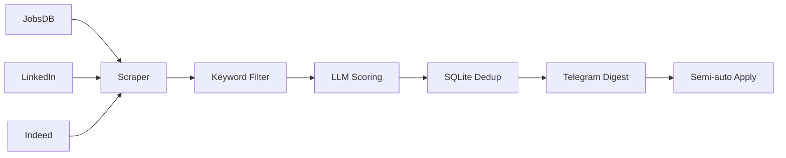

# HK Job Radar · 香港岗位雷达

> **Your personal, AI-assisted job search automation for Hong Kong.**
> Watch new jobs across three boards → filter → score → daily push (WeCom / Email / Telegram / WxPusher) → semi-auto apply.
> Local-first, privacy-first, compliance-first.
>
> **一个本地运行、AI 辅助的香港求职自动化工具。**
> 自动监控三大招聘网站的新岗位 → 关键词初筛 → 大模型打分 → 每日推送（企业微信 / 邮件 / Telegram / WxPusher）→ 半自动填表。
> 数据不出本机，合规克制，配置驱动。

<p align="center">
  
  
  
  
  
</p>

> 🍎 **On a Mac?** One-click install via `.command` scripts —
> see **[Mac 安装教程 →](docs/mac-安装教程.md)** (Chinese, click-by-click).
>
> 🧰 **Never used a terminal? / 完全新手？**
> Follow the step-by-step beginner's guide (Chinese, from installing Python to
> receiving your first digest): **[保姆级新手教程 →](docs/getting-started-zh.md)**
> No coding experience needed — the one-click installer does the work for you.

---

## English

### What it is

HK Job Radar is a **self-hosted job search assistant** for the Hong Kong market. It
periodically watches **JobsDB / LinkedIn / Indeed** for new postings, filters them by
your keywords, scores each one with an **LLM against your personal profile**, and
delivers a **daily digest to whichever channel you pick** — WeCom group bot, WxPusher,
email (HTML job cards), or Telegram (with ✅/❌ buttons). It also ships a
**semi-automatic application assistant** that fills in forms for you — the final
"Submit" is always yours to click.

It is **not** a job board, **not** a recruiter, and **not** a resume writer. It
automates the repetitive part of job hunting: *finding and shortlisting*.

### Who it's for

- **Anyone job-hunting in Hong Kong** — students, fresh graduates, career switchers.
  Set `career_stage: student / graduate / both` and the employment-type filter follows.
- **Especially non-local students on a Hong Kong student visa** — `career_stage: student`
  ships as the default and applies visa-compliance filtering
  (see [Compliance](#compliance--safety)).
- **Works for any role** — just list your own target job titles in `config.yaml`
  (the template ships with neutral product / business examples).

### The problem it solves

| Pain point | How HK Job Radar helps |
| --- | --- |
| Job listings are scattered across 3+ sites; refreshing them daily is exhausting | One local pipeline watches all three, automatically |
| Finding genuinely relevant roles in a sea of listings is hard | Keyword pre-filter + LLM relevance scoring (0–100) |
| Re-typing the same application form wastes hours | Semi-auto form filler + screening-answer generator |
| (Non-local students) unclear which roles are legal on a student visa | Built-in visa-compliance filtering (internship/part-time; management-trainee handled separately) |

### How it works



1. **Scrape** — each enabled source is fetched with random human-like delays and a
   per-site daily page cap (anti-ban first).
2. **Filter** — cheap keyword + synonym matching drops noise so the LLM only sees
   worthwhile roles.
3. **Score** — DeepSeek scores each role 0–100 against your profile; failures degrade
   gracefully instead of blocking the pipeline.
4. **Dedup + store** — SQLite double-key (job ID + normalized URL) guarantees no
   duplicate pushes.
5. **Notify** — a digest sorted by score (09:00 if the PC is on, otherwise the first
   time you power on that day) + instant push for new roles ≥ 80.
6. **Apply (optional)** — fills forms + uploads resume + drafts screening answers,
   then asks you to review every field and **click submit yourself**.

### Key features

- 🔎 **3-source monitoring** — JobsDB, LinkedIn, Indeed (each toggleable).
- 🧠 **LLM scoring** — DeepSeek (OpenAI-compatible; swap `base_url` for others).
- 📬 **4 push channels, all equal** — WeCom group bot / WxPusher / Email (HTML job
  cards) / Telegram. Pick any one in `config.yaml`; no channel is second-class.
- ✍️ **Semi-auto apply** — never auto-submits; final click is always human.
- 🛡️ **Anti-ban** — random delays, daily page caps, exponential backoff, no CAPTCHA
  cracking, no Cloudflare bypass.
- 🧩 **Config-driven** — keywords, location, career stage, profile, thresholds all in YAML.
- 🎓 **Career-stage aware** — `career_stage: student / graduate / both` sets the
  employment types automatically (student visa → internship/part-time only).
- 🔓 **Genuinely usable for free** — no account, no server, no phone-home; the paid
  tier only adds convenience and depth (see *Free vs Pro* below).

### Limitations

- **Some technical comfort helps** — though the one-click installer (`install.bat`
  on Windows, `install.command` on macOS) removes most of it; you still need a
  DeepSeek key and one configured push channel.
- **Depends on third-party sites** — scraping may be rate-limited or blocked at any
  time; LinkedIn & Indeed need a login / Cloudflare pass-through.
- **Not 100% coverage** — it's a radar, not a guarantee of every posting.
- **LLM score is an estimate** — a relevance signal, never a hiring decision.
- **The free tier is capped** — 7 keywords, 1 push channel, 1 digest per day, no
  instant push. These caps live in readable code and are a product contract, not DRM;
  the Pro feature set is simply not in this repository.

### Quick start

**Option A — One-click install, no terminal needed (Windows, recommended)**

1. Install [Python](https://www.python.org/downloads/) — tick **"Add python.exe to PATH"**.
2. On this page click **Code → Download ZIP**, then unzip it.
3. Double-click **`install.bat`** — it sets everything up and asks for your DeepSeek key.
4. Open `config.yaml` in Notepad → set `notify.channels` to the one channel you want
   (`wecom` / `wxpusher` / `email` / `telegram`) and fill in that channel's block,
   set `career_stage` (`student` / `graduate` / `both`), **and replace `keywords`
   with your own target roles** (the template ships with neutral examples).
5. Open `data/profiles/profile.yaml` in Notepad → fill in **your own background**
   (this is what the LLM scores jobs against — don't skip it).
6. Double-click **`login_jobsdb.bat`** once (Cloudflare pass-through).
7. Double-click **`start.bat`** (keep it running) — or **`run_once.bat`** for a
   single sweep. Either way you get a digest the first time you run it that day,
   and new high-scoring jobs are pushed as they appear.

> Steps 4–5 are the two things the installer **cannot** do for you: describing *what
> you're looking for* and *who you are*. Skip them and the tool still runs, but it
> will fetch the wrong roles and score them against an empty profile.
> Exact click-by-click steps: [beginner's guide](docs/getting-started-zh.md) (Chinese).

**Option A2 — One-click install on macOS (no terminal needed)**

Same flow, but the files end in `.command` instead of `.bat`:

1. Install [Python 3.10+ for macOS](https://www.python.org/downloads/macos/)
   (the Python that ships with macOS is 3.9 and is too old).
2. **Code → Download ZIP**, unzip it, and move the folder to `/Users/<you>/`
   (**avoid Desktop / Documents / Downloads** — macOS guards those and the
   browser may fail with `Operation not permitted`).
3. **Control-click `install.command` → Open → Open** (first launch only; macOS
   blocks downloaded scripts — see `MAC-打不开就读我.txt` if the button is missing).
4. Fill in `config.yaml` (bot token, your keywords) and
   `data/profiles/profile.yaml` — same as Windows steps 4–5.
5. Double-click `login_jobsdb.command` once, then `run_once.command` (single sweep)
   or `start.command` (keep running).

`install.command` also registers a **daily 09:00 launchd job**; if the Mac is asleep
at that moment, it runs on wake. Remove it any time with `关闭自动运行.command`.

> Full version, with every screen explained:
> **[Mac 安装教程 →](docs/mac-安装教程.md)**

**Option B — Manual (terminal, one-time setup)**

```powershell
# 1. Clone & enter
git clone https://github.com/prui0474/hk-job-radar.git
cd hk-job-radar

# 2. Virtual env + deps + Chromium
python -m venv .venv
.venv\Scripts\Activate.ps1
pip install -r requirements.txt
playwright install chromium

# 3. Config + profile
Copy-Item config.example.yaml config.yaml
Copy-Item data/profiles/profile.example.yaml data/profiles/profile.yaml

# 4. LLM key — either an env var, or a one-line api_key.txt next to config.yaml
$env:DEEPSEEK_API_KEY = "sk-..."      # env var (or: create api_key.txt containing just sk-...)

# 5. Edit config.yaml → set notify.channels + that channel's block (see config.example.yaml)

# 6. One-time login (Cloudflare / LinkedIn)
python run.py login jobsdb
python run.py login linkedin
python run.py login indeed
```

> **Windows encoding note.** The first line of `requirements.txt`
> (`# -*- coding: utf-8 -*-`) is there on purpose. On Simplified-Chinese Windows,
> pip would otherwise decode that file with GBK and abort with
> `UnicodeDecodeError: 'gbk' codec can't decode byte ...`. Keep the line.
> The bundled `.bat` files also set `PYTHONUTF8=1`, so Chinese/emoji console
> output stays intact even when the window output is redirected to a file.

**Daily use — after either option, just this:**

```powershell
python run.py once             # run ONE sweep, push the digest, then exit (or double-click run_once.bat)
python run.py run              # keep monitoring in the foreground (or double-click start.bat)
python run.py report now       # send today's digest immediately
python run.py stats            # today's fetch/new/push counts
python run.py apply <job_uid>  # semi-auto application assistant
```

> **Don't leave your PC on all day?** Use `once` / `run_once.bat`. It does one full
> sweep, scores the jobs, pushes the digest, and exits — so a 15-minute session is
> enough. The digest is also auto-sent when you power on if it hasn't gone out yet.
> See `docs/uptime-strategy.md`.

### Configuration

Everything is in `config.yaml` (see `config.example.yaml` for commented defaults):

| Key | What it does |
| --- | --- |
| `sources` | which boards to enable |
| `keywords` | your target job titles (up to 7 on the free tier) |
| `graduate_keywords` | post-graduation full-time roles (management trainee, …) |
| `career_stage` | `student` = internship/part-time · `graduate` = full-time · `both` |
| `job_types` | advanced override; normally derived from `career_stage` |
| `notify.channels` | which push channel(s) to enable — all four are equal |
| `notify.wecom` / `wxpusher` / `email` / `telegram` | credentials for each channel |
| `keyword_rotation` | how many keywords to search per cycle (tune to your uptime) |
| `daily_limits` | per-site page cap per Hong Kong calendar day |
| `location` | target region |
| `score_threshold` / `realtime_threshold` | 60 = daily, 80 = instant push |
| `report_time` | daily digest time (HK) |

The `background` section of `data/profiles/profile.yaml` drives LLM scoring — **you must
replace the placeholders with your own** skills, experience, and target roles. If that
section is missing or still holds only `<placeholders>`, the tool falls back to a generic
description and scores become far less meaningful.

> 中文：`data/profiles/profile.yaml` 的 `background:` 段是 AI 打分的依据，**必须换成
> 你自己的**背景与目标岗位。若该段缺失、或仍是一堆 `<占位符>`，程序会退回一段通用
> 描述来打分，分数参考价值很低（但不会报错——这是最容易被忽略的一步）。

### Compliance & safety

- **No auto-submit** — the code has no path that submits an application; the final
  click is always yours.
- **No CAPTCHA cracking / Cloudflare bypass** — challenges are waited on or handed to
  you, never solved.
- **Secrets never committed** — API keys come from env vars; real config and profile
  are gitignored; only templates are public.
- **Student-visa aware** — `career_stage: student` (the default) keeps
  internship/part-time only; switch to `graduate` / `both` only after you hold IANG.

### Free vs Pro

Everything needed to actually run a job radar is in this repository — nothing is
crippled, nothing phones home, no account required.

| | Free (this repo) | Pro (closed-source pack, separate download) |
| --- | --- | --- |
| Job boards | all of them | all of them |
| Keywords | up to **7** | unlimited |
| Push channels | **1** — WeCom / WxPusher / Email / Telegram, your pick | all at once |
| Daily digest | **1 per day** (scheduled or manual) | custom schedule, several per day |
| Instant push for ≥80 | — | yes |
| Profiles (search directions) | 1 | several in parallel |
| Setup wizard & self-check | included | included |
| Graphical job workspace | — | yes |
| Trend dashboard · application tracker | — | yes |
| Resume-vs-JD gap analysis · interview prep | — | yes |
| Polished HTML report · Excel / PDF export | — | yes |

**Why the caps exist:** they only apply to things whose marginal cost grows with use
(LLM spend, scraping quota, and human support time). The free build is a complete,
genuinely useful radar — seven well-chosen keywords cover most Hong Kong
data / quant / BA searches, and one channel is enough to receive results.

**A note on honesty:** these caps live in readable code in this repository, because
MIT means you own the code. They are a product contract, not DRM. The Pro feature set
is kept **out of this repository entirely** — that is the only lock that actually
works. Build your own if you like; the free tier is not a demo.

### Project structure

```
hk_job_radar/
├── install.bat / start.bat / run_once.bat      # Windows: double-click these
├── install.command / start.command / run_once.command  # macOS: double-click these
├── MAC-打不开就读我.txt                          # macOS: what to do if they won't open
├── scripts/
│   ├── common.sh                  # shared shell helpers for the .command scripts
│   └── check_encoding.py          # guard against the line-ending / encoding class of bugs
├── .github/workflows/check.yml    # free macOS + Windows CI on every push
├── config.example.yaml            # config template (copy → config.yaml)
├── data/profiles/profile.example.yaml  # profile template (copy → profile.yaml)
├── src/hk_job_radar/
│   ├── scrapers/                  # jobsdb / linkedin / indeed adapters
│   ├── scoring/                   # keyword filter + LLM scorer
│   ├── copilot/                   # semi-auto apply (form filler + QA)
│   ├── notify/                    # 4 push channels: base / dispatch / wecom / wxpusher / email / telegram
│   ├── tier.py                    # free-tier caps in one place (see Free vs Pro)
│   ├── pipeline.py / scheduler.py
│   └── config.py / db.py / models.py
├── docs/                          # beginner guides (Windows + macOS)
└── tests/                         # unit tests (pure, no network)
```

> **Why the CI runs on macOS**: the author develops on Windows, so a real macOS
> runner is the only honest way to verify the Mac path. Every push installs the
> project, downloads Chromium, runs `stats`, and checks the launchd job — see
> [`.github/workflows/check.yml`](.github/workflows/check.yml).

### License

[MIT](LICENSE)

---

## 中文

### 这是什么

香港岗位雷达是一个**本地运行的求职助手**：定时监控 **JobsDB / LinkedIn / Indeed**
三大网站的新岗位，按你的关键词初筛，用**大模型（DeepSeek）对照你的个人画像打分**，
每天推送到**你自选的一个通道**——企业微信群机器人 / WxPusher / 邮件（HTML 岗位卡片）/
Telegram（带 ✅/❌ 反馈按钮）；还附带一个**半自动投递副驾**，
帮你填申请表——但**最后的「提交」永远由你亲手点击**。

它**不是**求职网站、**不是**猎头、**不是**代写简历，它只自动处理求职里最重复的
那部分：*找岗位 + 筛选岗位*。

### 适合谁

- **任何在香港求职的人**——学生、应届生、转行者都能用；用 `career_stage` 选身份，
  岗位类型过滤会自动跟着变；
- **尤其适合持学生签证的港硕/非本地学生**（默认 `career_stage: student`，内置签证合规过滤，见下）；
- 岗位方向**完全由你自己在 `config.yaml` 里定义**（模板自带中性的产品 / 商业示例），改配置即可覆盖任意岗位。

### 解决什么痛点

| 痛点 | 本工具怎么解决 |
| --- | --- |
| 岗位分散在多个网站，每天手动刷新太累 | 一条本地流水线自动盯三个站 |
| 海量岗位里找到真正匹配的很难 | 关键词初筛 + LLM 相关度打分（0–100） |
| 重复填申请表浪费时间 | 半自动填表 + 筛选问题答案生成 |
| （非本地学生）搞不清哪些岗位学生签能合法做 | 内置签证合规过滤 |

### 核心优点

- 🔎 三站监控，各自可开关
- 🧠 LLM 打分（DeepSeek，OpenAI 兼容，可换其他服务）
- 📬 **四个推送通道完全平等**——企业微信 / WxPusher / 邮件（HTML 卡片）/ Telegram，
  在 `config.yaml` 里选一个即可，没有谁是"二等公民"
- ✍️ 半自动投递，绝不自动提交
- 🛡️ 防封号：随机延迟、每日页数上限、指数退避，不破解验证码
- 🧩 配置驱动，可复用到任何求职目标
- 🎓 按求职阶段自动过滤岗位类型（`career_stage`：学生 / 已毕业 / 两者）
- 🔓 **免费版就是完整可用的**——不需要账号、不需要服务器、不上传任何数据；
  付费版只增加「省事」与「深度」（见下「免费版与高级版」）

### 局限

- 有一定技术门槛——不过「一键安装脚本」已省去大部分；仍需自备 DeepSeek key 和配好一个推送通道
  （Windows 双击 `install.bat`，macOS 双击 `install.command`，流程一样）
- 依赖第三方站点，抓取可能被限流或临时封锁（LinkedIn/Indeed 需登录过盾）
- 不保证 100% 覆盖——它是「雷达」，不是「全量抓取」
- LLM 打分是相关度参考，不是录用决定
- **免费版有额度上限**——7 个关键词、1 个推送通道、每天 1 次日报、不含实时秒推。
  这些限制写在可读的代码里（`src/hk_job_radar/tier.py`），是产品约定而非加密锁；
  高级版的功能则**完全不在这份仓库里**。

### 快速上手

**方式 A —— 一键安装，全程不用敲命令（Windows，推荐）**

1. 安装 [Python](https://www.python.org/downloads/)——务必勾选 **"Add python.exe to PATH"**
2. 在本页面点 **Code → Download ZIP**，下载后解压
3. 双击 **`install.bat`**——自动装好一切，还会引导你填 DeepSeek key
4. 用记事本打开 `config.yaml` → 在 `notify.channels` 里写你要用的通道
   （`wecom` / `wxpusher` / `email` / `telegram` 任选一个，四者完全平等）并填好它
   下面的那几行；设好 `career_stage`（`student` / `graduate` / `both`）；
   **再把 `keywords` 换成你自己要找的岗位**（模板自带的是中性示例词）
5. 用记事本打开 `data/profiles/profile.yaml` → 填**你自己的真实背景**
   （这是 AI 打分所依据的画像，别跳过）
6. 双击一次 **`login_jobsdb.bat`**（过一次防护验证）
7. 双击 **`start.bat`**（保持窗口开着）；只想跑一轮就双击 **`run_once.bat`**。
   当天第一次运行就会收到一份日报，之后新出现的达标岗位会推送。

> 第 4、5 步是安装脚本**唯一帮不了你**的两件事：**你想找什么**、**你是谁**。
> 跳过它们，程序照样会跑，但会抓错岗位、再拿一份空画像去打分。
> 每一步点哪里，见[保姆级新手教程](docs/getting-started-zh.md)。

**方式 A2 —— Mac 一键安装，同样不用敲命令**

流程完全一样，只是文件后缀从 `.bat` 换成 `.command`：

1. 安装 [Mac 版 Python 3.10+](https://www.python.org/downloads/macos/)
   （Mac 自带的那个太旧，不够用）
2. **Code → Download ZIP**，解压后把文件夹挪到 `/Users/你的名字/` 下
   （**别放在桌面/文稿/下载里运行**，那三个位置被系统保护，浏览器可能报
   `Operation not permitted`）
3. **按住 Control 点 `install.command` →「打开」→ 再点「打开」**
   （只有第一次需要这样，因为文件是从网上下载的；找不到「打开」按钮就看
   项目里的 `MAC-打不开就读我.txt`）
4. 填 `config.yaml` 和 `data/profiles/profile.yaml`——和 Windows 的第 4、5 步一样
5. 双击一次 `login_jobsdb.command`，然后双击 `run_once.command`（只跑一轮）
   或 `start.command`（一直挂着）

`install.command` 会顺手注册**每天 09:00 自动运行**（电脑当时在睡觉也会在
唤醒后补跑）；不想要就双击 `关闭自动运行.command`。

> 每一步点哪里、每个窗口长什么样，见 **[Mac 安装教程](docs/mac-安装教程.md)**。

**方式 B —— 手动安装（终端，只需一次）**

```powershell
git clone https://github.com/prui0474/hk-job-radar.git
cd hk-job-radar
python -m venv .venv
.venv\Scripts\Activate.ps1
pip install -r requirements.txt
playwright install chromium

Copy-Item config.example.yaml config.yaml
Copy-Item data/profiles/profile.example.yaml data/profiles/profile.yaml
$env:DEEPSEEK_API_KEY = "sk-..."   # 填自己的 key
# 编辑 config.yaml：设 notify.channels（wecom / wxpusher / email / telegram 任选其一）并填好凭据

python run.py login jobsdb        # 首次过盾/登录（三站各跑一次）
python run.py login linkedin
python run.py login indeed
```

> **Windows 中文编码提示（别删那一行）。** `requirements.txt` 的第一行
> `# -*- coding: utf-8 -*-` 是刻意保留的：简体中文 Windows 下 pip 默认会用 GBK
> 解码该文件，从而崩在 `UnicodeDecodeError: 'gbk' codec can't decode byte ...`。
> 项目里的 7 个 `.bat` 也统一设了 `PYTHONUTF8=1`，保证窗口输出被重定向到文件时
> 中文与 emoji 不会抛 `UnicodeEncodeError`。

**日常使用 —— 无论哪种方式安装，之后就这两三条命令：**

```powershell
python run.py once                # 只抓一轮就退出并推日报（或直接双击 run_once.bat）
python run.py run                 # 启动监控（或直接双击 start.bat）
python run.py report now          # 立刻补发一次日报
python run.py stats               # 查看今日抓取/推送统计
python run.py apply <job_uid>     # 投递副驾（半自动填表）
```

> **不想整天开着电脑？** 用 `once` / `run_once.bat`：抓一轮 → 打分 → 推日报 → 自动退出，
> 开机十几分钟就够。日报若在开机时还没发过，也会自动补发。
> 详见 `docs/uptime-strategy.md`。

### 合规与安全

- **不自动提交投递**——代码里没有任何自动提交路径，最后一下永远由你点；
- **不破解验证码、不绕过 Cloudflare**；
- **密钥不入库**——API key 走环境变量，真实配置与画像已被 gitignore；
- **按求职阶段过滤**——默认 `career_stage: student` 只抓实习/兼职（学生签证合规）；
  拿到 IANG 后改成 `graduate` 或 `both` 即可。

### 免费版与高级版

跑起一个真正能用的岗位雷达所需的全部代码都在这份仓库里——没有任何功能被"阉割"，
不需要账号，不上传任何数据。

| | 免费版（本仓库） | 高级版（闭源包，单独分发） |
| --- | --- | --- |
| 招聘网站 | 全部 | 全部 |
| 关键词 | 最多 **7 个** | 不限 |
| 推送通道 | **1 个**——企业微信 / WxPusher / 邮件 / Telegram 任选 | 全部同时开启 |
| 每日日报 | **每天 1 次**（定时或手动） | 自定义频率，一天多次 |
| ≥80 分实时秒推 | — | ✅ |
| 个人画像 | 1 份 | 多份（多方向并行） |
| 配置向导 · 一键自检 | ✅ 免费 | ✅ |
| 图形岗位工作台 | — | ✅ |
| 趋势看板 · 投递管理 | — | ✅ |
| 简历-JD 差距分析 · 面试预测 | — | ✅ |
| 精美 HTML 报告 · 导出 Excel/PDF | — | ✅ |

**为什么要有额度上限：** 上限只加在"用一次就多一份成本"的地方（AI 调用费、抓取配额、
以及作者的人工答疑时间）。免费版本身是完整的、真的好用的雷达——7 个选得准的关键词
足以覆盖香港大多数数据 / 量化 / 商业分析方向的搜索，一个通道也足够收到结果。

**一句实话：** 本仓库是 MIT 协议，所以免费版的额度限制就写在可读的代码里
（`src/hk_job_radar/tier.py`）——**它是产品约定，不是加密锁**。真正有效的那道锁是：
**高级版的功能源码根本不在这份仓库里**。想自己动手改，欢迎；不想折腾，高级版就是
用来省掉这些事的。

### License

[MIT](LICENSE)
