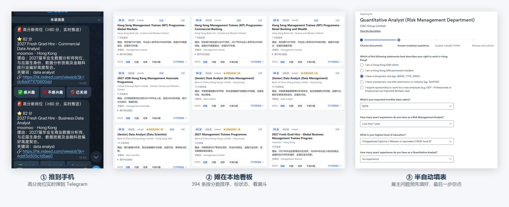
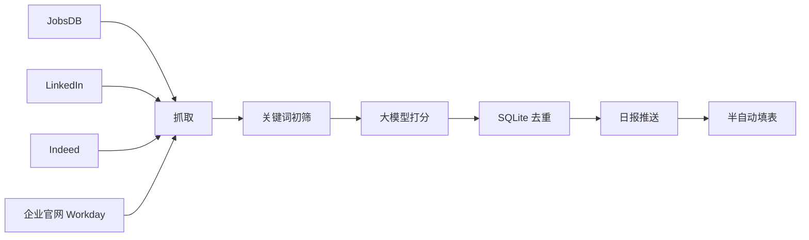
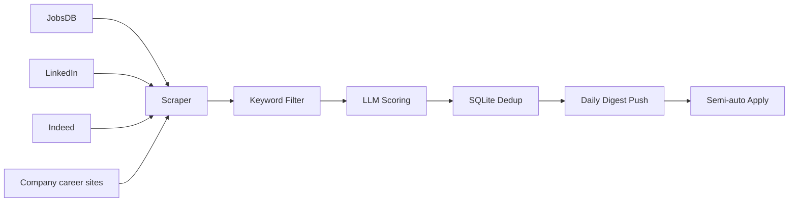

# HK Job Radar · 香港岗位雷达

> **一个本地运行、AI 辅助的香港求职自动化工具。完全免费，没有付费版本。**
> 自动监控三个招聘网站 + 各大企业官网直招的新岗位 → 关键词初筛 → 大模型打分 → 每日推送（企业微信 / WxPusher / 邮件 / Telegram）→ 半自动填表。
> 数据不出本机，合规克制，配置驱动。
>
> **Your personal, AI-assisted job search automation for Hong Kong. Free, with no paid tier.**
> Watch new jobs across three job boards and company career sites → filter → score → daily push (WeCom / WxPusher / Email / Telegram) → semi-auto apply.
> Local-first, privacy-first, compliance-first.

<p align="center">
  
</p>

<p align="center">
  
  
  
  
  
  <a href="https://github.com/prui0474/hk-job-radar/stargazers">
    
  </a>
</p>

> 🍎 **On a Mac?** One-click install via `.command` scripts —
> see **[Mac 安装教程 →](docs/mac-安装教程.md)** (Chinese, click-by-click).
>
> 🧰 **Never used a terminal? / 完全新手？**
> Follow the step-by-step beginner's guide (Chinese, from installing Python to
> receiving your first digest): **[保姆级新手教程 →](docs/getting-started-zh.md)**
> No coding experience needed — the one-click installer does the work for you.
>
> 🌐 **English version:** [jump to English ↓](#english)

---

## 中文

### 这是什么

香港岗位雷达是一个**本地运行的求职助手**：定时监控 **JobsDB / LinkedIn / Indeed**
三个招聘网站，外加**企业官网直招**（走 Workday 招聘系统的机构，内置宏利、永明、
中信银行国际等五家，也能自己加），按你的关键词初筛，
用**大模型（DeepSeek）对照你的个人画像打分**，
每天推送到**你自选的一个通道**——企业微信群机器人 / WxPusher / 邮件（HTML 岗位卡片）/
Telegram（带 ✅/❌ 反馈按钮）；还附带一个**半自动投递副驾**，
帮你填申请表——但**最后的「提交」永远由你亲手点击**。

它**不是**求职网站、**不是**猎头、**不是**代写简历，它只自动处理求职里最重复的
那部分：*找岗位 + 筛选岗位*。

### 适合谁

- **任何在香港求职的人**——学生、应届生、转行者都能用；用 `career_stage` 选身份，
  岗位类型过滤会自动跟着变；
- **尤其适合持学生签证的港硕/非本地学生**（默认 `career_stage: student`，内置签证合规过滤，见下）；
- 岗位方向**完全由你自己定**——双击 `setup.bat`（Mac 上是 `setup.command`），在打开的网页里填；
  向导会先预填几个常见方向当示例，改成你自己的就行，覆盖任意岗位。

### 解决什么痛点

| 痛点 | 本工具怎么解决 |
| --- | --- |
| 打开 JobsDB 翻一遍、再 LinkedIn、再 Indeed，两个多小时过去了，真正投出去的也就那么几份 | 一条本地流水线按点盯住三个站和企业官网，你只在日报里挑 |
| 翻了一整个下午，一百个岗位里真正能投的就那么几个，其余全在耗你的时间和耐心 | 关键词初筛 + LLM 相关度打分（0–100），能投的排在最前面 |
| 重复填申请表浪费时间 | 半自动填表 + 筛选问题答案生成 |
| （非本地学生）搞不清哪些岗位学生签能合法做 | 内置签证合规过滤 |

### 工作原理



1. **抓取** — 每个开启的站都按随机的人为延迟抓，并限制单站每日页数（防封号优先）。
   企业官网走的是各家招聘系统自己的公开接口（Workday），比翻网页稳，也不用过人机验证。
2. **初筛** — 先用关键词和同义词做便宜的匹配，把噪音丢掉，这样只有值得看的岗位才会
   送进大模型，省的是你自己的 API 钱。
3. **打分** — DeepSeek 对着你的个人画像给每个岗位打 0–100 分，顺带读一遍岗位写明的
   准入条件（须为香港永久居民、要求粤语之类），作为提示标在卡片上——只提示、不扣分，
   能不能投由你自己判断；调用失败会降级处理，不会把整条流水线卡死。
4. **去重入库** — SQLite 用「岗位 ID + 归一化 URL」双键去重，保证同一个岗位不会被
   推第二遍。
5. **推送** — 按分数排序的日报（电脑开着就 09:00 发，当天第一次开机也会补发）；
   新出现的 ≥80 分岗位会立刻单独推一条，不用等到第二天。
6. **投递（可选）** — 帮你填表、传简历、起草筛选问题的答案，然后请你逐项核对、
   **自己点「提交」**。

### 核心优点

- 🔎 **四个来源，各自可开关**——JobsDB / LinkedIn / Indeed 三个招聘站，加上企业官网（Workday）
- 🧠 **LLM 打分**（DeepSeek，OpenAI 兼容，想换别家也行）：按你的画像逐条打分，附一句理由
- 📬 **四个推送通道，爱开几个开几个**——企业微信 / WxPusher / 邮件（HTML 卡片）/ Telegram，
  同时开也行（Telegram 看推送、邮件留个档）。其中 Telegram 多一层反馈：日报里每个岗位都带
  ✅ / ❌ 按钮，点一下就把「感兴趣 / 不感兴趣」记进本机数据库，岗位状态跟着变成「感兴趣」
  或「已排除」——一条条攒下来，就是你自己看得懂的求职偏好档案
- ⚡ **高分岗位抓到就推**；日报想发几份也由你定，早晚各一份，
  或者只在真有新岗位落地时才响。香港的岗位经常上午挂出来、下午就约面，
  这个差别直接体现在你投得早不早
- ♻️ **同一个岗位在几个站各挂一份，只当一份看**——公司名与职位名归一化后比对，
  日报里两条都留但标出「同一岗位另见」，实时推送只响一次，不会同一个职位把你叫起来两回
- 🗂️ **积压的岗位摊在一张页面上挑，而不是在聊天记录里往上翻**——工作台按分数排开，
  可以按来源 / 分数 / 新鲜度筛，看过的、标过的、不想看的各自归位
- 📈 **市场在怎么变、你投到了哪一步，两件事放在一起看**——趋势看板盯着你关注的方向：
  这周放出多少岗位、集中在哪些薪资区间、哪几家在连续招。投递那边不用来回翻记录：
  一张本地看板把岗位摊成卡片，点标题直接跳回原站去投；投完在卡片上点「已投」，约到了点
  「约面」，告一段落点「结束」——公司、岗位、日期、走的哪个站自动留档，
  投出去多少、有多少回音，图上直接看
- ✍️ **投递副驾**——申请页上那些「你有几年经验」「期望月薪多少」的选择题，按你的口径替你
  选好，停在最后一页等你核对；**提交那一下永远是你点**
- 🔁 **已投记录同步**——你已经投过的岗位，从招聘网站读回来一次性标好，不用回卡片一张张点
- 🎯 **投之前知道自己差在哪，投之后知道会被问什么**——简历和 JD 逐项对照，指出它要、
  而你没写出来的那句该补在哪；面试预测按这条 JD 把可能的问题先过一遍
- 📄 **最后一份能直接发出去的东西**——精美 HTML 报告，也能导出 Excel / PDF，
  给导师、给朋友，或者自己留档
- 🎓 按求职阶段自动过滤岗位类型（`career_stage`：学生 / 已毕业 / 两者）
- 🛡️ 防封号：随机延迟、每日页数上限、指数退避，不破解验证码
- 🧩 配置驱动，可复用到任何求职目标
- 🔓 **不需要服务器，数据不出本机**——整套东西都在你自己电脑上跑

### 实际效果

真实录屏（本地库里 394 条岗位）：筛出 80 分以上 → 展开岗位描述 → 标记已投 → 撤销。

<p align="center">
  
</p>

### 局限

- 有一定技术门槛——不过「一键安装脚本」已省去大部分；仍需自备 DeepSeek key 和配好一个推送通道
  （Windows 双击 `install.bat`，macOS 双击 `install.command`，流程一样）
- 依赖第三方站点，抓取可能被限流或临时封锁。**LinkedIn 需要真实账号**并登录一次；
  JobsDB、Indeed 和企业官网不需要账号，只要过一次人机验证（企业官网连这一步都没有）
- 不保证 100% 覆盖——它是「雷达」，不是「全量抓取」
- **关键词要靠你自己想**——它只会按你写的词去找，写得太窄就会漏。
  好消息是没有数量限制，把同义词、缩写、中英文写法都铺上去就行。

### 网络要求

程序只连下面这几个地方，除此之外不往任何地方发数据：

| 用途 | 域名 | 什么时候需要 |
| --- | --- | --- |
| 抓岗位 | `hk.jobsdb.com` | 开启 JobsDB（带 Cloudflare 防护，要过一次人机验证） |
| 抓岗位 | `hk.indeed.com` | 开启 Indeed |
| 抓岗位 | `www.linkedin.com` | 开启 LinkedIn（需要账号） |
| 抓岗位 | 各企业自己的招聘域名（如 `*.myworkdayjobs.com`） | 开启「企业官网」来源 |
| AI 打分 | `api.deepseek.com` | 始终需要 |
| 推送 | `api.telegram.org` | 选了 Telegram |
| 推送 | `qyapi.weixin.qq.com` | 选了企业微信 |
| 推送 | `wxpusher.zjiecode.com` | 选了 WxPusher |
| 推送 | 你的邮箱 SMTP 服务器 | 选了邮件 |

**地区由网址决定，不由 IP 决定。** 三个招聘站抓的都是 `hk.` 子域、或用
`location: Hong Kong` 参数定位；企业官网那边按城市筛，只要 `Hong Kong` 的。
所以不论你人在香港、英国、加拿大还是内地，抓回来的都是**香港的岗位**。

| 你在哪 | 情况 |
| --- | --- |
| **香港** | 直连就行，不需要任何代理 |
| **海外（英国 / 加拿大 / 澳洲等）** | 上表域名基本都通，**不需要代理**。DeepSeek API 在海外可直接调用，只有延迟略高。唯一要留意的是 **LinkedIn 的异地登录风控**（见下） |
| **内地** | `challenges.cloudflare.com`、`www.google.com`、`api.telegram.org` 都不通，人机验证框会一直转圈。需要开代理（TUN / 虚拟网卡模式最省事），或把 `browser.proxy` 设成 `system`。见[新手教程附 B](docs/getting-started-zh.md) |

> **LinkedIn 的异地登录**：LinkedIn 对「会话从一个地区突然跳到另一个地区」很敏感，
> 可能要求重新验证甚至临时限制账号。所以**在哪个地区用，就在那个地区登一次**
> （双击 `login_linkedin.bat` / `.command`）。
> JobsDB 和 Indeed 不需要账号，换地区完全没影响——省事的话，关掉 LinkedIn 只跑这两个。

### 快速上手

**方式 A —— 一键安装，全程不用敲命令（Windows，推荐）**

1. 安装 [Python](https://www.python.org/downloads/)——务必勾选 **"Add python.exe to PATH"**
2. 在本页面点 **Code → Download ZIP**，下载后解压
3. 双击 **`install.bat`**，然后跟着窗口走就行——它会一口气做完这些事：
   - 装好依赖和浏览器内核，并引导你填 DeepSeek key；
   - **自动打开配置页面**：你在这里填**要找的岗位**、**选一个推送通道**、
     填**你自己的背景**，点「保存配置」→「关闭向导」；
   - **自动做 15 项自检**，全绿才往下走，有 ❌ 就直接写明该改哪一行；
   - **自动打开浏览器**，让你过一次 JobsDB 的安全验证。
4. 看到 `全部就绪。` 之后，双击 **`start.bat`**（**保持窗口开着**）；
   只想跑一轮就双击 **`run_once.bat`**。
   当天第一次运行就会收到一份日报，之后新出现的达标岗位会推送。
   **`start.bat` 关掉之后就不会再自动跑了**——Windows 上「每天 09:00」
   靠的是这个窗口一直在（Mac 上不一样，见方式 A2）。

> 以后**再双击一次 `install.bat`** 只会检查环境，不会再弹配置页，
> 收尾显示「环境已就绪，你的配置保持原样」。这是正常的，不是出错。
> 想改配置就双击 `setup.bat`。

> 整个流程里**只有一件事机器替不了你**：告诉它**你想找什么岗位**、**你是谁**。
> 这两处就在第 3 步自动打开的配置页面里。跳过它们，程序照样会跑，但会抓错岗位、
> 再拿一份空画像去打分。
> 每一步点哪里，见[保姆级新手教程](docs/getting-started-zh.md)。
>
> **拿不准自己配对了没有？双击 `doctor.bat`。** 它会把 15 项逐个查一遍，
> 缺什么就直说该改哪一行——不用猜，也不用等我回复。
> 装完之后想改关键词或推送通道，双击 `setup.bat` 再走一遍那个页面即可。

**方式 A2 —— Mac 一键安装，同样不用敲命令**

流程完全一样，只是文件后缀从 `.bat` 换成 `.command`：

1. 安装 [Mac 版 Python 3.10+](https://www.python.org/downloads/macos/)
   （Mac 自带的那个太旧，不够用）
   > **系统要求：macOS 11（Big Sur）或更新**——python.org 从 Python 3.10 起只提供
   > macOS 11 及以上的安装包；10.15 及更早的系统装不上官方 Python，不建议硬来。
   > 查版本：屏幕左上角 Apple 菜单 →「关于本机」。
2. **Code → Download ZIP**，解压后把文件夹挪到 `/Users/你的名字/` 下
   （**别放在桌面/文稿/下载里运行**，那三个位置被系统保护，浏览器可能报
   `Operation not permitted`）
3. **按住 Control 点 `install.command` →「打开」→ 再点「打开」**
   （只有第一次需要这样，因为文件是从网上下载的；找不到「打开」按钮就看
   项目里的 `MAC-打不开就读我.txt`）
   —— 之后它和 Windows 一样，把配置页面、15 项自检、 JobsDB 安全验证
   一口气带完，中途不用你再判断该点哪个文件
4. 看到 `全部就绪。` 之后，双击 `run_once.command`（只跑一轮）或
   `start.command`（一直挂着）

`install.command` 会顺手注册**每天 09:00 自动运行**（电脑当时在睡觉也会在
唤醒后补跑），**不用一直开着窗口**；不想要就双击 `关闭自动运行.command`。

> **Windows 上没有这层定时任务**，那边靠 `start.bat` 一直开着。
> 不想整天开着电脑的话，用 `run_once.bat` 手动跑一轮，或者开「任务计划程序」
> 自己加一条定时任务指向 `run_once.bat`。

> 每一步点哪里、每个窗口长什么样，见 **[Mac 安装教程](docs/mac-安装教程.md)**。

**方式 B —— 手动安装（终端，只需一次）**

```powershell
git clone https://github.com/prui0474/hk-job-radar.git
cd hk-job-radar
python -m venv .venv
.venv\Scripts\Activate.ps1
pip install -r requirements.txt
playwright install chromium

Copy-Item config.example.yaml config.yaml
Copy-Item data/profiles/profile.example.yaml data/profiles/profile.yaml
$env:DEEPSEEK_API_KEY = "sk-..."   # 填自己的 key
# 编辑 config.yaml：设 notify.channels（wecom / wxpusher / email / telegram 任选其一）并填好凭据

python run.py login jobsdb        # 首次过盾/登录（JobsDB / LinkedIn / Indeed 各一次，企业官网不用）
python run.py login linkedin
python run.py login indeed
```

> **Windows 中文编码提示（别删那一行）。** `requirements.txt` 的第一行
> `# -*- coding: utf-8 -*-` 是刻意保留的：简体中文 Windows 下 pip 默认会用 GBK
> 解码该文件，从而崩在 `UnicodeDecodeError: 'gbk' codec can't decode byte ...`。
> 项目里的 **11 个 `.bat`** 也统一设了 `PYTHONUTF8=1`，保证窗口输出被重定向到文件时
> 中文与 emoji 不会抛 `UnicodeEncodeError`。

**日常使用 —— 无论哪种方式安装，常用的就下面这几条：**

```powershell
python run.py once                # 只抓一轮就退出并推日报（或直接双击 run_once.bat）
python run.py run                 # 启动监控（或直接双击 start.bat）
python run.py report now          # 立刻补发一次日报
python run.py notify test         # 给推送通道发一条测试消息（配完通道后先点这个，10 秒验证）
python run.py doctor              # 一键自检：15 项体检，逐条告诉你哪里没配好、怎么修
python run.py stats               # 查看今日抓取/推送统计
python run.py apply <job_uid>     # 投递副驾（半自动填表）
```

> **不想整天开着电脑？** 用 `once` / `run_once.bat`：抓一轮 → 打分 → 推日报 → 自动退出，
> 开机十几分钟就够。日报若在开机时还没发过，也会自动补发。
> 详见 `docs/uptime-strategy.md`。

### 配置项说明

所有设置在 `config.yaml` 里（`config.example.yaml` 是带逐行注释的模板）。
**不想碰文本文件就双击 `setup.bat`（Mac 上是 `setup.command`），在网页里点。**

| 配置项 | 作用 |
| --- | --- |
| `sources` | 开启哪几个招聘站 |
| `keywords` | 你要找的岗位名称，数量不限 |
| `graduate_keywords` | 毕业后的全职岗位（管理培训生等）；与上面合计不超过 7 个 |
| `career_stage` | `student` = 只抓实习/兼职 · `graduate` = 全职 · `both` = 两者 |
| `job_types` | 高级覆盖项；正常由 `career_stage` 自动推导，一般不用手填 |
| `notify.channels` | 用哪个推送通道——四个完全平等，写在第一位的就是生效的那个 |
| `notify.wecom` / `wxpusher` / `email` / `telegram` | 各通道自己的凭据，只填你选中的那一个 |
| `keyword_rotation` | 每轮搜几个关键词（按你每天开机多久来调） |
| `daily_limits` | 单站每个香港自然日的页数上限 |
| `location` | 目标地区，默认 Hong Kong |
| `score_threshold` / `realtime_threshold` | 60 = 进日报的分数线；80 = 抓到就单独推的分数线 |
| `max_job_age_days` / `report_max_age_days` | 2 = 只抓最近 2 天发布的；3 = **无法复核**的站点（LinkedIn）入库超过 3 天还没推出去就不再推送 |
| `liveness_check` | 推送前打开详情页确认还在招（Indeed / JobsDB）。开启时能复核的站点不再按天数砍，只留 30 天硬上限 |
| `report_time` | 日报时间（香港时间） |
| `resume_path` | 简历文件路径（`.docx` / `.txt` / `.md`）。留空＝不用「简历-JD 差距分析」，其它一切照常 |

`data/profiles/profile.yaml` 的 `background:` 段是 AI 打分的依据，**必须换成你自己的**
技能、经历与目标岗位。若该段缺失、或仍是一堆 `<占位符>`，程序会退回一段通用描述来打分，
分数参考价值很低（但不会报错——这是最容易被忽略的一步）。

### 合规与安全

- **不自动提交投递**——代码里没有任何自动提交路径，最后一下永远由你点；
- **不破解验证码、不绕过 Cloudflare**；
- **按求职阶段过滤**——默认 `career_stage: student` 只抓实习/兼职（学生签证合规）；
  拿到 IANG 后改成 `graduate` 或 `both` 即可。

### Star 统计

<a href="https://star-history.com/#prui0474/hk-job-radar&Date">
  
</a>

如果你对这个项目感兴趣，点个 star 或者随缘打赏 就是最直接的鼓励。

### 支持这个项目

如果你用它拿到了面试、或者只是觉得省了时间，可以请我喝杯咖啡。万分感谢你的支持，祝你早日找到高薪的心仪offer！

<details>
<summary>☕ 随缘打赏（点击展开收款码）</summary>

<p align="center">
  
  
  
  
</p>

<p align="center">
  <sub>微信支付 · WeChat Pay HK · 支付宝 · AlipayHK</sub>
</p>

</details>

### 联系

有问题、想反馈，或者想一起改这个项目：邮箱 **P_RUI@outlook.com**
（标题里带一句「岗位雷达」，我一眼就能认出来）。

### Contact

Questions, feedback, or want to help improve it: email **P_RUI@outlook.com**
(put "HK Job Radar" in the subject line).

### License

[MIT](LICENSE)

---

## English

### What it is

HK Job Radar is a **self-hosted job search assistant** for the Hong Kong market. It
periodically watches **JobsDB / LinkedIn / Indeed** as well as **company career sites**
running on Workday (Manulife, Sun Life, CNCBI and more built in), filters them by your
keywords, scores each one with an **LLM against your personal profile**, and
delivers a **daily digest to whichever channel you pick** — WeCom group bot, WxPusher,
email (HTML job cards), or Telegram (with ✅/❌ buttons). It also ships a
**semi-automatic application assistant** that fills in forms for you — the final
"Submit" is always yours to click.

It is **not** a job board, **not** a recruiter, and **not** a resume writer. It
automates the repetitive part of job hunting: *finding and shortlisting*.

### Who it's for

- **Anyone job-hunting in Hong Kong** — students, fresh graduates, career switchers.
  Set `career_stage: student / graduate / both` and the employment-type filter follows.
- **Especially non-local students on a Hong Kong student visa** — `career_stage: student`
  ships as the default and applies visa-compliance filtering
  (see [Compliance](#compliance--safety)).
- **Works for any role** — list your own target job titles on the `setup` page (a local
  browser form). Nothing is hard-coded to one field; the wizard just prefills a few
  common examples for you to overwrite.

### The problem it solves

| Pain point | How HK Job Radar helps |
| --- | --- |
| Three boards, three search forms, three rounds of scrolling — open JobsDB, then LinkedIn, then Indeed, and two hours are gone for maybe three applications actually sent | A local pipeline watches all three (plus company career sites) on schedule; you only show up for the shortlist |
| A whole afternoon of scrolling: out of a hundred postings, perhaps five are worth applying to — the other ninety-five quietly eat your day | Keyword pre-filter + LLM relevance scoring (0–100), so the roles that fit open the digest |
| Re-typing the same application form wastes hours | Semi-auto form filler + screening-answer generator |
| (Non-local students) unclear which roles are legal on a student visa | Built-in visa-compliance filtering (internship/part-time; management-trainee handled separately) |

### How it works



1. **Scrape** — each enabled source is fetched with random human-like delays and a
   per-site daily page cap (anti-ban first). Company career sites are read through
   their own public job API (Workday): steadier than page scraping, and no human
   verification involved.
2. **Filter** — cheap keyword + synonym matching drops noise so the LLM only sees
   worthwhile roles.
3. **Score** — DeepSeek scores each role 0–100 against your profile and also flags any
   eligibility conditions the ad states outright (permanent-resident only, Cantonese
   required, …) as a note on the card — a note only, never a deduction; whether to apply
   stays your call. Failures degrade gracefully instead of blocking the pipeline.
4. **Dedup + store** — SQLite double-key (job ID + normalized URL) guarantees no
   duplicate pushes.
5. **Notify** — a digest sorted by score (09:00 if the PC is on, otherwise the first
   time you power on that day). Roles at ≥ 80 are also pushed the moment they are found.
6. **Apply (optional)** — fills forms + uploads resume + drafts screening answers,
   then asks you to review every field and **click submit yourself**.

### Key features

- 🔎 **4 sources, each toggleable** — JobsDB / LinkedIn / Indeed plus company career sites (Workday).
- 🧠 **LLM scoring** — DeepSeek (OpenAI-compatible; swap `base_url` for others), with a
  one-line reason attached to every score.
- 📬 **4 push channels — turn on as many as you like** — WeCom group bot / WxPusher /
  Email (HTML job cards) / Telegram. All at once is fine (Telegram for the ping, email for
  the archive). Telegram adds a feedback layer: every job in the digest carries ✅ / ❌
  buttons, one tap records *interested / not interested* in your local database and flips
  that job's status, so your own taste accumulates as a record you can read back.
- ⚡ **High-scoring roles are pushed the moment they are found.** Hong Kong roles often go
  up in the morning and are interviewing by the afternoon — this is the difference between
  applying early and applying late. Digest cadence is yours too: twice a day, or only when
  something new actually lands.
- ♻️ **One posting listed on several boards counts once** — company and title are
  normalised and compared; the digest keeps both lines but marks "same job, see #N",
  and instant push fires once instead of waking you up twice for the same role.
- 🗂️ **The backlog laid out on one page instead of scrolled up in a chat** — a graphical
  workspace sorted by score, filterable by source / score / freshness.
- 📈 **How the market moves and how far you got, side by side** — the trend board watches
  your directions: how many roles came out this week, which salary bands they cluster in,
  which employers keep posting. The application side is just clicks: a local board lays
  the roles out as cards, and applied / interview / closed is one click on the card.
  One glance shows what went out and what came back.
- ✍️ **Application co-pilot** — picks the answers to those screening questions (years of
  experience, expected salary, right to work), stops on the last page for you to check.
  **The final click is always yours.**
- 🔁 **Applied-jobs sync** — reads back the applications you already sent on JobsDB and
  marks them in one go, instead of clicking each card.
- 🎯 **Know the gap before you apply, know the questions after** — resume-vs-JD comparison
  points at the line the JD wants and your resume never shows; interview prep rehearses
  the questions that JD invites.
- 📄 **And one thing you can actually send** — a polished HTML report, exportable to
  Excel / PDF, for a mentor, a friend, or your own records.
- 🎓 **Career-stage aware** — `career_stage: student / graduate / both` sets the
  employment types automatically (student visa → internship/part-time only).
- 🛡️ **Anti-ban** — random delays, daily page caps, exponential backoff, no CAPTCHA
  cracking, no Cloudflare bypass.
- 🧩 **Config-driven** — keywords, location, career stage, profile, thresholds all in YAML.
- 🔓 **No server involved, nothing leaves your machine.**

### See it in action

Recorded from the real board (394 jobs in the local database): filter to 80+ → expand a job
description → mark it applied → undo.

<p align="center">
  
</p>

### Limitations

- **Some technical comfort helps** — though the one-click installer (`install.bat`
  on Windows, `install.command` on macOS) removes most of it; you still need a
  DeepSeek key and one configured push channel.
- **Depends on third-party sites** — scraping may be rate-limited or blocked at any
  time. LinkedIn needs a real account and a one-time login; JobsDB, Indeed and company career
  sites need no account at all — the first two just need one human-verification pass.
- **Not 100% coverage** — it's a radar, not a guarantee of every posting.
- **Keywords are on you** — it only looks for what you write, so a narrow list means
  missed roles. There is no cap, so pile on synonyms, abbreviations and the Chinese /
  English variants of the same title.

### Network requirements

The tool talks to these hosts and nothing else:

`hk.jobsdb.com` · `hk.indeed.com` · `www.linkedin.com` · `api.deepseek.com` ·
your employers' own hiring domains (`*.myworkdayjobs.com` when that company runs on
Workday) — plus one push channel (`api.telegram.org` / `qyapi.weixin.qq.com` /
`wxpusher.zjiecode.com` / your SMTP server).

**Region is decided by URL, not by your IP.** All three boards are queried through
their Hong Kong subdomain or a `location: Hong Kong` parameter, and company career
sites are filtered down to `Hong Kong` — so you get Hong Kong postings wherever you are.

| Where you are | What to expect |
| --- | --- |
| Hong Kong | works directly, no proxy |
| Overseas (UK, Canada, Australia…) | every host above is reachable, **no proxy needed**; the DeepSeek API works globally with slightly higher latency. The one thing to watch is **LinkedIn's location-based login checks** |
| Mainland China | `challenges.cloudflare.com`, `www.google.com` and `api.telegram.org` are unreachable — the verification widget will spin forever. Use a proxy in TUN mode, or set `browser.proxy: system` |

> **LinkedIn and changing regions**: LinkedIn is sensitive to a session jumping
> between countries and may demand re-verification or temporarily restrict the
> account. Log in again from wherever you actually are (double-click
> `login_linkedin.bat` / `.command`). JobsDB and Indeed need no account, so they are
> unaffected — disabling LinkedIn and running those two is the friction-free option.

### Quick start

**Option A — One-click install, no terminal needed (Windows, recommended)**

1. Install [Python](https://www.python.org/downloads/) — tick **"Add python.exe to PATH"**.
2. On this page click **Code → Download ZIP**, then unzip it.
3. Double-click **`install.bat`** and follow the window. It chains the rest of the
   setup for you:
   - installs dependencies and the browser engine, and asks for your DeepSeek key;
   - **opens the setup page automatically** — fill in *what you're looking for*
     (target job titles), *who you are* (the background the AI scores against), and
     *where to send messages* (pick one of the four channels and paste its
     credentials). Click **Save**, then **Close wizard**. No YAML editing, no
     indentation to get wrong;
   - **runs the 15-item self-check automatically**, and only continues when it is
     all green — anything marked with a cross tells you exactly what to change;
   - **opens a browser for the one-time JobsDB verification**.
4. Once it prints `全部就绪。` ("all set"), double-click **`start.bat`** and **leave it
   running** — or **`run_once.bat`** for a single sweep. Either way you get a digest
   the first time you run it that day, and new high-scoring jobs are pushed as they
   appear. On Windows the 09:00 schedule lives **inside that window**: close it and
   the daily digests stop (macOS is different — see Option A2).

> Running `install.bat` a second time only re-checks the environment: it does not
> reopen the setup page, and it ends with "环境已就绪，你的配置保持原样" ("environment
> ready, your settings are untouched"). That is expected, not a failure.

> The one thing the installer **cannot** do for you is describing *what you're
> looking for* and *who you are* — that is the setup page it opens for you in step 3.
> Skip it and the tool still runs, but it will fetch the wrong roles and score them
> against an empty profile.
> Exact click-by-click steps: [beginner's guide](docs/getting-started-zh.md) (Chinese).
> Want to change keywords or the push channel later? Double-click `setup.bat`.

**Option A2 — One-click install on macOS (no terminal needed)**

Same flow, but the files end in `.command` instead of `.bat`:

1. Install [Python 3.10+ for macOS](https://www.python.org/downloads/macos/)
   (the Python that ships with macOS is 3.9 and is too old).
2. **Code → Download ZIP**, unzip it, and move the folder to `/Users/<you>/`
   (**avoid Desktop / Documents / Downloads** — macOS guards those and the
   browser may fail with `Operation not permitted`).
3. **Control-click `install.command` → Open → Open** (first launch only; macOS
   blocks downloaded scripts — see `MAC-打不开就读我.txt` if the button is missing).
   It then walks the same chain as Windows: setup page → self-check → JobsDB
   verification, without asking you to pick the next file.
4. Once it prints `全部就绪。`, double-click `run_once.command` (single sweep) or
   `start.command` (keep running).

`install.command` also registers a **daily 09:00 launchd job**; if the Mac is asleep
at that moment, it runs on wake. **No window needs to stay open.** Remove it any time
with `关闭自动运行.command`.

> Windows has no equivalent scheduled task — there the 09:00 digest depends on
> `start.bat` staying open. To avoid leaving the PC on all day, use `run_once.bat`
> in a single sweep, or add a Task Scheduler entry pointing at it.

> Full version, with every screen explained:
> **[Mac 安装教程 →](docs/mac-安装教程.md)**

**Option B — Manual (terminal, one-time setup)**

```powershell
# 1. Clone & enter
git clone https://github.com/prui0474/hk-job-radar.git
cd hk-job-radar

# 2. Virtual env + deps + Chromium
python -m venv .venv
.venv\Scripts\Activate.ps1
pip install -r requirements.txt
playwright install chromium

# 3. Config + profile
Copy-Item config.example.yaml config.yaml
Copy-Item data/profiles/profile.example.yaml data/profiles/profile.yaml

# 4. LLM key — either an env var, or a one-line api_key.txt next to config.yaml
$env:DEEPSEEK_API_KEY = "sk-..."      # env var (or: create api_key.txt containing just sk-...)

# 5. Fill in the config — this opens a setup page in your browser
python run.py setup
#    (prefer editing YAML by hand? config.example.yaml is fully commented)

# 6. One-time login (Cloudflare / LinkedIn)
python run.py login jobsdb
python run.py login linkedin
python run.py login indeed
```

> **Windows encoding note.** The first line of `requirements.txt`
> (`# -*- coding: utf-8 -*-`) is there on purpose. On Simplified-Chinese Windows,
> pip would otherwise decode that file with GBK and abort with
> `UnicodeDecodeError: 'gbk' codec can't decode byte ...`. Keep the line.
> The bundled `.bat` files also set `PYTHONUTF8=1`, so Chinese/emoji console
> output stays intact even when the window output is redirected to a file.

**Daily use — after either option, just this:**

```powershell
python run.py once             # run ONE sweep, push the digest, then exit (or double-click run_once.bat)
python run.py run              # keep monitoring in the foreground (or double-click start.bat)
python run.py report now       # send today's digest immediately
python run.py notify test      # send a test message to your push channel(s) — verify setup in 10s
python run.py doctor           # self-check: 15 items, says exactly what is still misconfigured
python run.py setup            # open the in-browser setup page (edit the config without YAML)
python run.py stats            # today's fetch/new/push counts
python run.py apply <job_uid>  # semi-auto application assistant
```

> **Don't leave your PC on all day?** Use `once` / `run_once.bat`. It does one full
> sweep, scores the jobs, pushes the digest, and exits — so a 15-minute session is
> enough. The digest is also auto-sent when you power on if it hasn't gone out yet.
> See `docs/uptime-strategy.md`.

### Configuration

Everything is in `config.yaml` (see `config.example.yaml` for commented defaults):

| Key | What it does |
| --- | --- |
| `sources` | which boards to enable |
| `keywords` | your target job titles, no limit on how many |
| `graduate_keywords` | post-graduation full-time roles (management trainee, …) |
| `career_stage` | `student` = internship/part-time · `graduate` = full-time · `both` |
| `job_types` | advanced override; normally derived from `career_stage` |
| `notify.channels` | which push channel(s) to enable — all four are equal |
| `notify.wecom` / `wxpusher` / `email` / `telegram` | credentials for each channel |
| `keyword_rotation` | how many keywords to search per cycle (tune to your uptime) |
| `daily_limits` | per-site page cap per Hong Kong calendar day |
| `location` | target region |
| `score_threshold` / `realtime_threshold` | 60 = digest threshold, 80 = push-on-sight threshold |
| `max_job_age_days` / `report_max_age_days` | 2 = only scrape postings from the last 2 days; 3 = for sources that **cannot** be re-checked (LinkedIn), never push anything that has sat unpushed for 3 days |
| `liveness_check` | open the job page before pushing to confirm it is still open (Indeed / JobsDB). While on, re-checkable sources are no longer cut by age — only a 30-day hard ceiling applies |
| `report_time` | daily digest time (HK) |
| `resume_path` | Path to your resume (`.docx` / `.txt` / `.md`). Leave it empty to skip resume-vs-JD analysis — everything else works the same |

The `background` section of `data/profiles/profile.yaml` drives LLM scoring — **you must
replace the placeholders with your own** skills, experience, and target roles. If that
section is missing or still holds only `<placeholders>`, the tool falls back to a generic
description and scores become far less meaningful.

> 中文：`data/profiles/profile.yaml` 的 `background:` 段是 AI 打分的依据，**必须换成
> 你自己的**背景与目标岗位。若该段缺失、或仍是一堆 `<占位符>`，程序会退回一段通用
> 描述来打分，分数参考价值很低（但不会报错——这是最容易被忽略的一步）。

### Compliance & safety

- **No auto-submit** — the code has no path that submits an application; the final
  click is always yours.
- **No CAPTCHA cracking / Cloudflare bypass** — challenges are waited on or handed to
  you, never solved.
- **Student-visa aware** — `career_stage: student` (the default) keeps
  internship/part-time only; switch to `graduate` / `both` only after you hold IANG.

### Star history

<a href="https://star-history.com/#prui0474/hk-job-radar&Date">
  
</a>

If this project is useful to you, a star — or a coffee if you feel like it — is the most
direct way to say so.

### Supporting the project

If it got you an interview, or just saved you an evening, you can buy me a coffee. Thank
you so much for the support — and may you land the well-paid offer you are after!

<details>
<summary>☕ Buy me a coffee (click to show the QR codes)</summary>

<p align="center">
  
  
  
  
</p>

<p align="center">
  <sub>WeChat Pay · WeChat Pay HK · Alipay · AlipayHK</sub>
</p>

</details>

### Project structure

```
hk_job_radar/
├── install.bat   / install.command   # one-click install (Windows / macOS)
├── setup.bat     / setup.command     # change settings: opens the setup page
├── doctor.bat    / doctor.command    # 15-item self-check
├── start.bat     / start.command     # keep running (this is what drives 09:00 on Windows)
├── run_once.bat  / run_once.command  # single sweep, then exit
├── login_jobsdb.bat / login_linkedin.bat / login_indeed.bat   # one-time verification / login
├── report_now.bat / notify_test.bat  # resend digest / test your push channel
├── board.bat     / board.command     # local job board: see the backlog, track progress
├── MAC-打不开就读我.txt              # macOS: what to do if they won't open
├── scripts/
│   ├── common.sh                  # shared shell helpers for the .command scripts
│   └── check_encoding.py          # guard against the line-ending / encoding class of bugs
├── .github/workflows/check.yml    # free macOS + Windows CI on every push
├── config.example.yaml            # config template (copy → config.yaml)
├── data/profiles/profile.example.yaml  # profile template (copy → profile.yaml)
├── src/hk_job_radar/
│   ├── scrapers/                  # jobsdb / linkedin / indeed / workday adapters
│   ├── scoring/                   # keyword filter + LLM scorer
│   ├── copilot/                   # application co-pilot (JobsDB wizard + form filler)
│   ├── notify/                    # 4 push channels: base / dispatch / wecom / wxpusher / email / telegram
│   ├── guard.py                   # strips hidden text and prompt-injection from job ads
│   ├── liveness.py                # re-checks whether a posting is still open
│   ├── doctor.py                  # 15-item self-check (double-click doctor.bat / .command)
│   ├── setup_wizard.py            # in-browser setup (double-click setup.bat / .command)
│   ├── setup_ui.html              # the setup page itself (single file, no external assets)
│   ├── channels.py                # the four push channels, one place
│   ├── workbench.py / workbench_ui.html   # local job board (server + single-file UI)
│   ├── dedup.py                   # cross-site duplicate detection
│   ├── applied_sync.py            # read applied jobs back from JobsDB
│   ├── export.py                  # HTML / Excel / PDF export
│   ├── resume.py / matcher.py     # resume parsing + resume-vs-JD comparison
│   ├── pipeline.py / scheduler.py
│   └── config.py / db.py / models.py
├── docs/                          # beginner guides (Windows + macOS)
└── tests/                         # unit tests (pure, no network)
```

> **Why the CI runs on macOS**: a real macOS runner is the only honest way to verify
> the Mac path — Windows can be checked locally, macOS cannot. Every push installs the
> project, downloads Chromium, runs `stats`, and checks the launchd job — see
> [`.github/workflows/check.yml`](.github/workflows/check.yml).

### License

[MIT](LICENSE)
