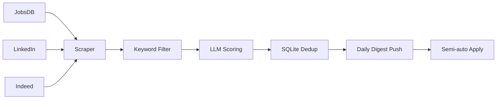

# HK Job Radar · 香港岗位雷达

> **一个本地运行、AI 辅助的香港求职自动化工具。**
> 自动监控三大招聘网站的新岗位 → 关键词初筛 → 大模型打分 → 每日推送（企业微信 / WxPusher / 邮件 / Telegram）→ 半自动填表。
> 数据不出本机，合规克制，配置驱动。
>
> **Your personal, AI-assisted job search automation for Hong Kong.**
> Watch new jobs across three boards → filter → score → daily push (WeCom / WxPusher / Email / Telegram) → semi-auto apply.
> Local-first, privacy-first, compliance-first.

<p align="center">
  
  
  
  
  
</p>

> 🍎 **On a Mac?** One-click install via `.command` scripts —
> see **[Mac 安装教程 →](docs/mac-安装教程.md)** (Chinese, click-by-click).
>
> 🧰 **Never used a terminal? / 完全新手？**
> Follow the step-by-step beginner's guide (Chinese, from installing Python to
> receiving your first digest): **[保姆级新手教程 →](docs/getting-started-zh.md)**
> No coding experience needed — the one-click installer does the work for you.
>
> 🌐 **English version:** [jump to English ↓](#english)

---

## 中文

### 这是什么

香港岗位雷达是一个**本地运行的求职助手**：定时监控 **JobsDB / LinkedIn / Indeed**
三大网站的新岗位，按你的关键词初筛，用**大模型（DeepSeek）对照你的个人画像打分**，
每天推送到**你自选的一个通道**——企业微信群机器人 / WxPusher / 邮件（HTML 岗位卡片）/
Telegram（带 ✅/❌ 反馈按钮）；还附带一个**半自动投递副驾**，
帮你填申请表——但**最后的「提交」永远由你亲手点击**。

它**不是**求职网站、**不是**猎头、**不是**代写简历，它只自动处理求职里最重复的
那部分：*找岗位 + 筛选岗位*。

### 适合谁

- **任何在香港求职的人**——学生、应届生、转行者都能用；用 `career_stage` 选身份，
  岗位类型过滤会自动跟着变；
- **尤其适合持学生签证的港硕/非本地学生**（默认 `career_stage: student`，内置签证合规过滤，见下）；
- 岗位方向**完全由你自己定**——双击 `setup.bat`，在打开的网页里填；
  向导会先预填几个常见方向当示例，改成你自己的就行，覆盖任意岗位。

### 解决什么痛点

| 痛点 | 本工具怎么解决 |
| --- | --- |
| 打开 JobsDB 翻一遍、再 LinkedIn、再 Indeed，两个多小时过去了，真正投出去的也就那么几份 | 一条本地流水线按点盯住三个站，你只在日报里挑 |
| 翻了一整个下午，一百个岗位里真正能投的就那么几个，其余全在耗你的时间和耐心 | 关键词初筛 + LLM 相关度打分（0–100），能投的排在最前面 |
| 重复填申请表浪费时间 | 半自动填表 + 筛选问题答案生成 |
| （非本地学生）搞不清哪些岗位学生签能合法做 | 内置签证合规过滤 |

### 核心优点

- 🔎 三站监控，各自可开关
- 🧠 LLM 打分（DeepSeek，OpenAI 兼容，可换其他服务）
- 📬 **四个推送通道，挑一个顺手的就行**——企业微信 / WxPusher / 邮件（HTML 卡片）/
  Telegram。其中 Telegram 多一层反馈：日报里每个岗位都带 ✅ / ❌ 按钮，点一下就把
  「感兴趣 / 不感兴趣」记进本机数据库，岗位状态跟着变成「感兴趣」或「已排除」——
  一条条攒下来，就是你自己看得懂的求职偏好档案
- ✍️ 半自动投递，绝不自动提交
- 🛡️ 防封号：随机延迟、每日页数上限、指数退避，不破解验证码
- 🧩 配置驱动，可复用到任何求职目标
- 🎓 按求职阶段自动过滤岗位类型（`career_stage`：学生 / 已毕业 / 两者）
- 🔓 **免费版就能跑通全流程**——三个站、关键词初筛、AI 打分、日报推送、半自动投递，
  全都在免费版里；不需要服务器，数据不出本机。
- ⚡ **高级版：同一套雷达，但这七件事是免费版做不到的**——
  - **一条关键词表，变成三条并行的求职线**——数据、量化、银行管培各挂一套关键词和分数门槛，
    早上看数据岗、下午看管培，互不覆盖，也不用改一次配置就重跑一遍。
  - **岗位早知道**——≥80 分的新岗位抓到就推，不用等到第二天早上 09:00；日报多久发一次
    也由你定，早晚各一份，或者只在真有新岗位落地时才响。香港的岗位经常上午挂出来、
    下午就约面，这个差别直接体现在你投得早不早。
  - **关键词想铺多少铺多少，四个通道也能同时开**——免费版是 7 个关键词、1 个通道，
    想加第八个就得先删掉一个。
  - **积压的岗位摊在一张页面上挑，而不是在聊天记录里往上翻**——图形工作台按分数排开，
    看过的、标过的、不想看的各自归位。
  - **市场在怎么变、你投到了哪一步，两件事放在一起看**——趋势看板盯着你关注的方向：
    这周放出多少岗位、集中在哪些薪资区间、哪几家在连续招。投递那边不用来回翻记录：
    一张本地看板把岗位摊成卡片，点标题直接跳回原站去投；投完在卡片上点「已投」，约到了点
    「约面」，告一段落点「结束」——公司、岗位、日期、走的哪个站、用的哪版简历自动留档，
    投出去多少、有多少回音，图上直接看。
  - **投之前知道自己差在哪，投之后知道会被问什么**——简历和 JD 逐项对照，指出它要、
    而你没写出来的那句该补在哪；面试预测按这条 JD 把可能的问题先过一遍。
  - **最后一份能直接发出去的东西**——精美 HTML 报告，也能导出 Excel / PDF，
    给导师、给朋友，或者自己留档。

### 局限

- 有一定技术门槛——不过「一键安装脚本」已省去大部分；仍需自备 DeepSeek key 和配好一个推送通道
  （Windows 双击 `install.bat`，macOS 双击 `install.command`，流程一样）
- 依赖第三方站点，抓取可能被限流或临时封锁。**LinkedIn 需要真实账号**并登录一次；
  JobsDB 和 Indeed 不需要账号，只要过一次人机验证
- 不保证 100% 覆盖——它是「雷达」，不是「全量抓取」
- **免费版有额度上限**——最多 7 个关键词、1 个推送通道、每天 1 次日报，不含实时秒推。
  完整对照见下方「免费版与高级版」一节。

### 快速上手

**方式 A —— 一键安装，全程不用敲命令（Windows，推荐）**

1. 安装 [Python](https://www.python.org/downloads/)——务必勾选 **"Add python.exe to PATH"**
2. 在本页面点 **Code → Download ZIP**，下载后解压
3. 双击 **`install.bat`**——自动装好一切，还会引导你填 DeepSeek key
4. 用记事本打开 `config.yaml` → 在 `notify.channels` 里写你要用的通道
   （`wecom` / `wxpusher` / `email` / `telegram` 任选一个，凭据只填你选的那个）并填好它
   下面的那几行；设好 `career_stage`（`student` / `graduate` / `both`）；
   **再在 `keywords` 下面填上你自己要找的岗位**（模板刻意留空，不预置默认词）
5. 用记事本打开 `data/profiles/profile.yaml` → 填**你自己的真实背景**
   （这是 AI 打分所依据的画像，别跳过）
6. 双击一次 **`login_jobsdb.bat`**（过一次防护验证）
7. 双击 **`doctor.bat`** —— 15 项自检。哪一项标了 ❌，它就写清了该怎么改；
   看着全绿了再往下走。
8. 双击 **`start.bat`**（保持窗口开着）；只想跑一轮就双击 **`run_once.bat`**。
   当天第一次运行就会收到一份日报，之后新出现的达标岗位会推送。

> 第 4、5 步是安装脚本**唯一帮不了你**的两件事：**你想找什么**、**你是谁**。
> 跳过它们，程序照样会跑，但会抓错岗位、再拿一份空画像去打分。
> 每一步点哪里，见[保姆级新手教程](docs/getting-started-zh.md)。
>
> **拿不准自己配对了没有？双击 `doctor.bat`。** 它会把 15 项逐个查一遍，
> 缺什么就直说该改哪一行——不用猜，也不用等我回复。

**方式 A2 —— Mac 一键安装，同样不用敲命令**

流程完全一样，只是文件后缀从 `.bat` 换成 `.command`：

1. 安装 [Mac 版 Python 3.10+](https://www.python.org/downloads/macos/)
   （Mac 自带的那个太旧，不够用）
2. **Code → Download ZIP**，解压后把文件夹挪到 `/Users/你的名字/` 下
   （**别放在桌面/文稿/下载里运行**，那三个位置被系统保护，浏览器可能报
   `Operation not permitted`）
3. **按住 Control 点 `install.command` →「打开」→ 再点「打开」**
   （只有第一次需要这样，因为文件是从网上下载的；找不到「打开」按钮就看
   项目里的 `MAC-打不开就读我.txt`）
4. 填 `config.yaml` 和 `data/profiles/profile.yaml`——和 Windows 的第 4、5 步一样
5. 双击一次 `login_jobsdb.command`
6. 双击 **`doctor.command`** —— 15 项自检，缺什么、怎么补都会写清楚；
   全绿了再往下走
7. 然后双击 `run_once.command`（只跑一轮）或 `start.command`（一直挂着）

`install.command` 会顺手注册**每天 09:00 自动运行**（电脑当时在睡觉也会在
唤醒后补跑）；不想要就双击 `关闭自动运行.command`。

> 每一步点哪里、每个窗口长什么样，见 **[Mac 安装教程](docs/mac-安装教程.md)**。

**方式 B —— 手动安装（终端，只需一次）**

```powershell
git clone https://github.com/prui0474/hk-job-radar.git
cd hk-job-radar
python -m venv .venv
.venv\Scripts\Activate.ps1
pip install -r requirements.txt
playwright install chromium

Copy-Item config.example.yaml config.yaml
Copy-Item data/profiles/profile.example.yaml data/profiles/profile.yaml
$env:DEEPSEEK_API_KEY = "sk-..."   # 填自己的 key
# 编辑 config.yaml：设 notify.channels（wecom / wxpusher / email / telegram 任选其一）并填好凭据

python run.py login jobsdb        # 首次过盾/登录（三站各跑一次）
python run.py login linkedin
python run.py login indeed
```

> **Windows 中文编码提示（别删那一行）。** `requirements.txt` 的第一行
> `# -*- coding: utf-8 -*-` 是刻意保留的：简体中文 Windows 下 pip 默认会用 GBK
> 解码该文件，从而崩在 `UnicodeDecodeError: 'gbk' codec can't decode byte ...`。
> 项目里的 7 个 `.bat` 也统一设了 `PYTHONUTF8=1`，保证窗口输出被重定向到文件时
> 中文与 emoji 不会抛 `UnicodeEncodeError`。

**日常使用 —— 无论哪种方式安装，之后就这两三条命令：**

```powershell
python run.py once                # 只抓一轮就退出并推日报（或直接双击 run_once.bat）
python run.py run                 # 启动监控（或直接双击 start.bat）
python run.py report now          # 立刻补发一次日报
python run.py notify test         # 给推送通道发一条测试消息（配完通道后先点这个，10 秒验证）
python run.py doctor              # 一键自检：15 项体检，逐条告诉你哪里没配好、怎么修
python run.py stats               # 查看今日抓取/推送统计
python run.py apply <job_uid>     # 投递副驾（半自动填表）
```

> **不想整天开着电脑？** 用 `once` / `run_once.bat`：抓一轮 → 打分 → 推日报 → 自动退出，
> 开机十几分钟就够。日报若在开机时还没发过，也会自动补发。
> 详见 `docs/uptime-strategy.md`。

### 合规与安全

- **不自动提交投递**——代码里没有任何自动提交路径，最后一下永远由你点；
- **不破解验证码、不绕过 Cloudflare**；
- **按求职阶段过滤**——默认 `career_stage: student` 只抓实习/兼职（学生签证合规）；
  拿到 IANG 后改成 `graduate` 或 `both` 即可。

### 免费版与高级版

跑起一条完整的岗位雷达所需的代码都在这份仓库里——不需要服务器，数据也不出本机。

| | 免费版 | 高级版 |
| --- | --- | --- |
| 招聘网站 | 全部 | 全部 |
| 关键词 | 最多 **7 个** | 不限 |
| 推送通道 | **1 个**——企业微信 / WxPusher / 邮件 / Telegram 任选 | 全部同时开启 |
| 每日日报 | **每天 1 次**（定时或手动） | 自定义频率，一天多次 |
| ≥80 分实时秒推 | — | ✅ |
| 个人画像 | 1 份 | 多份（多方向并行） |
| 配置向导 · 一键自检 | ✅ 免费 | ✅ |
| 图形岗位工作台 | — | ✅ |
| 趋势看板 · 投递管理 | — | ✅ |
| 简历-JD 差距分析 · 面试预测 | — | ✅ |
| 精美 HTML 报告 · 导出 Excel/PDF | — | ✅ |

**表格里每一行到底是什么意思**

- **招聘网站** — 两个版本一样，三个站全部开放，这里没有做任何保留。
- **关键词** — 程序拿去搜索的岗位名称。免费版最多 7 个（普通关键词 + 毕业生关键词合计），
  想把 data analyst / business analyst / data scientist / risk analyst / quant /
  management trainee / investment banking 一起铺，正好卡在上限；高级版不限个数，
  同义词、缩写、中英文两种写法都可以一起铺开。
- **推送通道** — 日报同时发到几处。免费版选一个；高级版四个随你选，哪个方便用哪个。
- **每日日报** — 免费版每天固定一份；高级版由你定节奏：早晚各一份，或者只在有新岗位时才发。
- **≥80 分实时秒推** — 免费版要等下一份日报才看见；高级版抓到几秒内就推到你手机上。
  香港的岗位经常上午挂出来、下午就约面，这个差别直接体现在你投得早不早。
- **个人画像** — 画像是「你是谁」（技能、经历、目标岗位），AI 拿它当打分的依据。免费版一份；
  高级版可以同时挂「数据分析」和「银行管培」两套，各自用自己的关键词和分数门槛，互不覆盖。
- **配置向导 · 一键自检** — 两个版本完全一样，不限次数、不砍功能。
- **图形岗位工作台** — 免费版是在聊天窗口或邮件里一条条往下看；高级版给一个本地页面，
  把积压的岗位摊开挑，标过的状态一眼看得见。
- **趋势看板 · 投递管理** — 把每个岗位记到「已投 / 约面 / 结束」，再用图表看这段时间投了
  多少、回了多少——哪条方向真的在出结果，一目了然。
- **简历-JD 差距分析 · 面试预测** — 拿某一条 JD 和你的简历逐项对照，指出它要、而你没写出来的
  技能该补哪一句；再针对这个岗位预演会被问什么。
- **精美 HTML 报告 · 导出 Excel / PDF** — 把一周或一个月的岗位整理成可以直接发出去的报告，
  给导师、给朋友看，或者自己留档。

**免费版让你不错过岗位，高级版让你把 offer 拿下来。**

祝你早日拿到心仪的高薪 offer！！！

### 联系

有问题、想反馈，或者想用高级版：微信 **pigrui-zr**（加的时候备注一句「岗位雷达」，通过快一些）。

### Contact

Questions, feedback, or interested in the Pro version: WeChat **pigrui-zr**
(a one-line note saying "HK Job Radar" gets you through faster).

### License

[MIT](LICENSE)

---

## English

### What it is

HK Job Radar is a **self-hosted job search assistant** for the Hong Kong market. It
periodically watches **JobsDB / LinkedIn / Indeed** for new postings, filters them by
your keywords, scores each one with an **LLM against your personal profile**, and
delivers a **daily digest to whichever channel you pick** — WeCom group bot, WxPusher,
email (HTML job cards), or Telegram (with ✅/❌ buttons). It also ships a
**semi-automatic application assistant** that fills in forms for you — the final
"Submit" is always yours to click.

It is **not** a job board, **not** a recruiter, and **not** a resume writer. It
automates the repetitive part of job hunting: *finding and shortlisting*.

### Who it's for

- **Anyone job-hunting in Hong Kong** — students, fresh graduates, career switchers.
  Set `career_stage: student / graduate / both` and the employment-type filter follows.
- **Especially non-local students on a Hong Kong student visa** — `career_stage: student`
  ships as the default and applies visa-compliance filtering
  (see [Compliance](#compliance--safety)).
- **Works for any role** — list your own target job titles on the `setup` page (a local
  browser form). Nothing is hard-coded to one field; the wizard just prefills a few
  common examples for you to overwrite.

### The problem it solves

| Pain point | How HK Job Radar helps |
| --- | --- |
| Three boards, three search forms, three rounds of scrolling — open JobsDB, then LinkedIn, then Indeed, and two hours are gone for maybe three applications actually sent | A local pipeline watches all three on schedule; you only show up for the shortlist |
| A whole afternoon of scrolling: out of a hundred postings, perhaps five are worth applying to — the other ninety-five quietly eat your day | Keyword pre-filter + LLM relevance scoring (0–100), so the roles that fit open the digest |
| Re-typing the same application form wastes hours | Semi-auto form filler + screening-answer generator |
| (Non-local students) unclear which roles are legal on a student visa | Built-in visa-compliance filtering (internship/part-time; management-trainee handled separately) |

### How it works



1. **Scrape** — each enabled source is fetched with random human-like delays and a
   per-site daily page cap (anti-ban first).
2. **Filter** — cheap keyword + synonym matching drops noise so the LLM only sees
   worthwhile roles.
3. **Score** — DeepSeek scores each role 0–100 against your profile; failures degrade
   gracefully instead of blocking the pipeline.
4. **Dedup + store** — SQLite double-key (job ID + normalized URL) guarantees no
   duplicate pushes.
5. **Notify** — a digest sorted by score (09:00 if the PC is on, otherwise the first
   time you power on that day) + instant push for new roles ≥ 80.
6. **Apply (optional)** — fills forms + uploads resume + drafts screening answers,
   then asks you to review every field and **click submit yourself**.

### Key features

- 🔎 **3-source monitoring** — JobsDB, LinkedIn, Indeed (each toggleable).
- 🧠 **LLM scoring** — DeepSeek (OpenAI-compatible; swap `base_url` for others).
- 📬 **4 push channels — pick whichever fits your day** — WeCom group bot / WxPusher /
  Email (HTML job cards) / Telegram. Telegram adds a feedback layer: every job in the
  digest carries ✅ / ❌ buttons, one tap records *interested / not interested* in your
  local database and flips that job's status, so your own taste accumulates as a record
  you can read back.
- ✍️ **Semi-auto apply** — never auto-submits; final click is always human.
- 🛡️ **Anti-ban** — random delays, daily page caps, exponential backoff, no CAPTCHA
  cracking, no Cloudflare bypass.
- 🧩 **Config-driven** — keywords, location, career stage, profile, thresholds all in YAML.
- 🎓 **Career-stage aware** — `career_stage: student / graduate / both` sets the
  employment types automatically (student visa → internship/part-time only).
- 🔓 **The free build runs the whole pipeline** — three boards, keyword filter, LLM
  scoring, digest push, semi-auto apply. No server involved, nothing leaves your machine.
- ⚡ **The Pro pack: the same radar — seven things the free build cannot do:**
  - **One keyword list becomes three job hunts running in parallel** — data / quant /
    bank MT each carry their own keywords and threshold; look at data roles in the
    morning and MT roles after lunch, without overwriting config and re-running.
  - **You hear about a role while it is still fresh** — instant push at ≥80 instead of
    waiting for tomorrow's 09:00 digest, and digests at whatever rhythm you set: twice
    a day, or only when something new actually lands. Hong Kong roles often go up in
    the morning and are interviewing by the afternoon — this is the difference between
    applying early and applying late.
  - **As many keywords as you need, and all four channels at once** — the free build gives
    you seven keywords and one channel: adding an eighth means dropping one.
  - **The backlog laid out on one page instead of scrolled up in a chat** — a graphical
    workspace sorted by score, with seen / marked / passed roles filed away.
  - **How the market moves and how far you got, side by side** — the trend board watches
    your directions: how many roles came out this week, which salary bands they cluster
    in, which employers keep posting. The application side is just clicks: a local board
    lays the roles out as cards, a click on the title jumps back to the original posting,
    and applied / interview / closed is one click on the card. Company, role, date, board
    and resume version file themselves; one glance shows what went out and what came back.
  - **Know the gap before you apply, know the questions after** — resume-vs-JD comparison
    points at the line the JD wants and your resume never shows; interview prep rehearses
    the questions that JD invites.
  - **And one thing you can actually send** — a polished HTML report, exportable to
    Excel / PDF, for a mentor, a friend, or your own records.

### Limitations

- **Some technical comfort helps** — though the one-click installer (`install.bat`
  on Windows, `install.command` on macOS) removes most of it; you still need a
  DeepSeek key and one configured push channel.
- **Depends on third-party sites** — scraping may be rate-limited or blocked at any
  time. LinkedIn needs a real account and a one-time login; JobsDB and Indeed only need
  a one-time human verification pass.
- **Not 100% coverage** — it's a radar, not a guarantee of every posting.
- **The free tier is capped** — up to 7 keywords, 1 push channel, 1 digest per day,
  no instant push. See *Free vs Pro* below for the full comparison.

### Quick start

**Option A — One-click install, no terminal needed (Windows, recommended)**

1. Install [Python](https://www.python.org/downloads/) — tick **"Add python.exe to PATH"**.
2. On this page click **Code → Download ZIP**, then unzip it.
3. Double-click **`install.bat`** — it sets everything up and asks for your DeepSeek key.
4. Double-click **`setup.bat`** — a browser page opens on your own machine. Fill in
   four boxes: *what you're looking for* (your target job titles), *who you are*
   (the background the AI scores against), *where to send messages* (pick one of
   the four channels and paste its credentials), and *when to send the daily digest*.
   Click **Save**, then **Close wizard**. No YAML editing, no indentation to get wrong.
5. Double-click **`login_jobsdb.bat`** once (Cloudflare pass-through).
6. Double-click **`doctor.bat`** — a 15-item self-check. If anything is marked with
   a cross, it tells you exactly what to change. Run it until it is all green.
7. Double-click **`start.bat`** (keep it running) — or **`run_once.bat`** for a
   single sweep. Either way you get a digest the first time you run it that day,
   and new high-scoring jobs are pushed as they appear.

> Step 4 is the one thing the installer **cannot** do for you: describing *what
> you're looking for* and *who you are*. Skip it and the tool still runs, but it
> will fetch the wrong roles and score them against an empty profile.
> Exact click-by-click steps: [beginner's guide](docs/getting-started-zh.md) (Chinese).

**Option A2 — One-click install on macOS (no terminal needed)**

Same flow, but the files end in `.command` instead of `.bat`:

1. Install [Python 3.10+ for macOS](https://www.python.org/downloads/macos/)
   (the Python that ships with macOS is 3.9 and is too old).
2. **Code → Download ZIP**, unzip it, and move the folder to `/Users/<you>/`
   (**avoid Desktop / Documents / Downloads** — macOS guards those and the
   browser may fail with `Operation not permitted`).
3. **Control-click `install.command` → Open → Open** (first launch only; macOS
   blocks downloaded scripts — see `MAC-打不开就读我.txt` if the button is missing).
4. Double-click **`setup.command`** and fill in the four boxes — same as Windows step 4.
5. Double-click `login_jobsdb.command` once.
6. Double-click **`doctor.command`** — a 15-item self-check that names whatever is
   still missing and how to fix it. Get it all green first.
7. Then `run_once.command` (single sweep) or `start.command` (keep running).

`install.command` also registers a **daily 09:00 launchd job**; if the Mac is asleep
at that moment, it runs on wake. Remove it any time with `关闭自动运行.command`.

> Full version, with every screen explained:
> **[Mac 安装教程 →](docs/mac-安装教程.md)**

**Option B — Manual (terminal, one-time setup)**

```powershell
# 1. Clone & enter
git clone https://github.com/prui0474/hk-job-radar.git
cd hk-job-radar

# 2. Virtual env + deps + Chromium
python -m venv .venv
.venv\Scripts\Activate.ps1
pip install -r requirements.txt
playwright install chromium

# 3. Config + profile
Copy-Item config.example.yaml config.yaml
Copy-Item data/profiles/profile.example.yaml data/profiles/profile.yaml

# 4. LLM key — either an env var, or a one-line api_key.txt next to config.yaml
$env:DEEPSEEK_API_KEY = "sk-..."      # env var (or: create api_key.txt containing just sk-...)

# 5. Fill in the config — this opens a setup page in your browser
python run.py setup
#    (prefer editing YAML by hand? config.example.yaml is fully commented)

# 6. One-time login (Cloudflare / LinkedIn)
python run.py login jobsdb
python run.py login linkedin
python run.py login indeed
```

> **Windows encoding note.** The first line of `requirements.txt`
> (`# -*- coding: utf-8 -*-`) is there on purpose. On Simplified-Chinese Windows,
> pip would otherwise decode that file with GBK and abort with
> `UnicodeDecodeError: 'gbk' codec can't decode byte ...`. Keep the line.
> The bundled `.bat` files also set `PYTHONUTF8=1`, so Chinese/emoji console
> output stays intact even when the window output is redirected to a file.

**Daily use — after either option, just this:**

```powershell
python run.py once             # run ONE sweep, push the digest, then exit (or double-click run_once.bat)
python run.py run              # keep monitoring in the foreground (or double-click start.bat)
python run.py report now       # send today's digest immediately
python run.py notify test      # send a test message to your push channel(s) — verify setup in 10s
python run.py doctor           # self-check: 15 items, says exactly what is still misconfigured
python run.py setup            # open the in-browser setup page (edit the config without YAML)
python run.py stats            # today's fetch/new/push counts
python run.py apply <job_uid>  # semi-auto application assistant
```

> **Don't leave your PC on all day?** Use `once` / `run_once.bat`. It does one full
> sweep, scores the jobs, pushes the digest, and exits — so a 15-minute session is
> enough. The digest is also auto-sent when you power on if it hasn't gone out yet.
> See `docs/uptime-strategy.md`.

### Configuration

Everything is in `config.yaml` (see `config.example.yaml` for commented defaults):

| Key | What it does |
| --- | --- |
| `sources` | which boards to enable |
| `keywords` | your target job titles (up to 7 on the free tier) |
| `graduate_keywords` | post-graduation full-time roles (management trainee, …) |
| `career_stage` | `student` = internship/part-time · `graduate` = full-time · `both` |
| `job_types` | advanced override; normally derived from `career_stage` |
| `notify.channels` | which push channel(s) to enable — all four are equal |
| `notify.wecom` / `wxpusher` / `email` / `telegram` | credentials for each channel |
| `keyword_rotation` | how many keywords to search per cycle (tune to your uptime) |
| `daily_limits` | per-site page cap per Hong Kong calendar day |
| `location` | target region |
| `score_threshold` / `realtime_threshold` | 60 = daily, 80 = instant push |
| `report_time` | daily digest time (HK) |

The `background` section of `data/profiles/profile.yaml` drives LLM scoring — **you must
replace the placeholders with your own** skills, experience, and target roles. If that
section is missing or still holds only `<placeholders>`, the tool falls back to a generic
description and scores become far less meaningful.

> 中文：`data/profiles/profile.yaml` 的 `background:` 段是 AI 打分的依据，**必须换成
> 你自己的**背景与目标岗位。若该段缺失、或仍是一堆 `<占位符>`，程序会退回一段通用
> 描述来打分，分数参考价值很低（但不会报错——这是最容易被忽略的一步）。

### Compliance & safety

- **No auto-submit** — the code has no path that submits an application; the final
  click is always yours.
- **No CAPTCHA cracking / Cloudflare bypass** — challenges are waited on or handed to
  you, never solved.
- **Student-visa aware** — `career_stage: student` (the default) keeps
  internship/part-time only; switch to `graduate` / `both` only after you hold IANG.

### Free vs Pro

Everything needed to run a complete job radar is in this repository — no server
involved, and nothing leaves your machine.

| | Free | Pro |
| --- | --- | --- |
| Job boards | all of them | all of them |
| Keywords | up to **7** | unlimited |
| Push channels | **1** — WeCom / WxPusher / Email / Telegram, your pick | all at once |
| Daily digest | **1 per day** (scheduled or manual) | custom schedule, several per day |
| Instant push for ≥80 | — | yes |
| Profiles (search directions) | 1 | several in parallel |
| Setup wizard & self-check | included | included |
| Graphical job workspace | — | yes |
| Trend dashboard · application tracker | — | yes |
| Resume-vs-JD gap analysis · interview prep | — | yes |
| Polished HTML report · Excel / PDF export | — | yes |

**What each row means**

- **Job boards** — the same three boards in both versions. Nothing is held back here.
- **Keywords** — the job titles the pipeline searches for. Free stops at 7 (regular +
  graduate keywords combined). Pro has no cap, so you can cover adjacent titles,
  abbreviations, and the Chinese / English variants of the same role.
- **Push channels** — free picks one; Pro sends to all four — whichever is convenient
  for you.
- **Daily digest** — free sends one per day; Pro lets you set the rhythm yourself:
  morning and evening, or only when something new actually landed.
- **Instant push for ≥80** — free users see it in the next digest; Pro gets it within
  seconds. Hong Kong postings are often decided first-come.
- **Profiles** — a profile is *who you are* (skills, experience, target roles), and it is
  what the LLM scores against. Free runs one direction; Pro runs several side by side,
  each with its own keywords and threshold, without overwriting the others.
- **Setup wizard & self-check** — identical in both versions; never limited.
- **Graphical job workspace** — free reads the backlog one message at a time; Pro opens
  a local page where the whole backlog is in front of you.
- **Trend dashboard · application tracker** — records how far each application got, and
  shows volume and response rate over time, so you can see which direction is working.
- **Resume-vs-JD gap analysis · interview prep** — compares one specific JD against your
  resume, names the skills it asks for and yours doesn't show, and rehearses the questions
  that JD invites.
- **Polished HTML report · Excel / PDF export** — turns a week or a month into a report
  you can hand to a mentor, send to a friend, or keep for yourself.

**The free build makes sure you miss nothing; Pro is about getting the offer.**

Here's to a high-paying offer you actually want — and to it landing soon.

### Project structure

```
hk_job_radar/
├── install.bat / start.bat / run_once.bat      # Windows: double-click these
├── install.command / start.command / run_once.command  # macOS: double-click these
├── MAC-打不开就读我.txt                          # macOS: what to do if they won't open
├── scripts/
│   ├── common.sh                  # shared shell helpers for the .command scripts
│   └── check_encoding.py          # guard against the line-ending / encoding class of bugs
├── .github/workflows/check.yml    # free macOS + Windows CI on every push
├── config.example.yaml            # config template (copy → config.yaml)
├── data/profiles/profile.example.yaml  # profile template (copy → profile.yaml)
├── src/hk_job_radar/
│   ├── scrapers/                  # jobsdb / linkedin / indeed adapters
│   ├── scoring/                   # keyword filter + LLM scorer
│   ├── copilot/                   # semi-auto apply (form filler + QA)
│   ├── notify/                    # 4 push channels: base / dispatch / wecom / wxpusher / email / telegram
│   ├── doctor.py                  # 15-item self-check (double-click doctor.bat / .command)
│   ├── setup_wizard.py            # in-browser setup (double-click setup.bat / .command)
│   ├── setup_ui.html              # the setup page itself (single file, no external assets)
│   ├── tier.py                    # free-tier caps in one place (see Free vs Pro)
│   ├── pipeline.py / scheduler.py
│   └── config.py / db.py / models.py
├── docs/                          # beginner guides (Windows + macOS)
└── tests/                         # unit tests (pure, no network)
```

> **Why the CI runs on macOS**: a real macOS runner is the only honest way to verify
> the Mac path — Windows can be checked locally, macOS cannot. Every push installs the
> project, downloads Chromium, runs `stats`, and checks the launchd job — see
> [`.github/workflows/check.yml`](.github/workflows/check.yml).

### License

[MIT](LICENSE)
