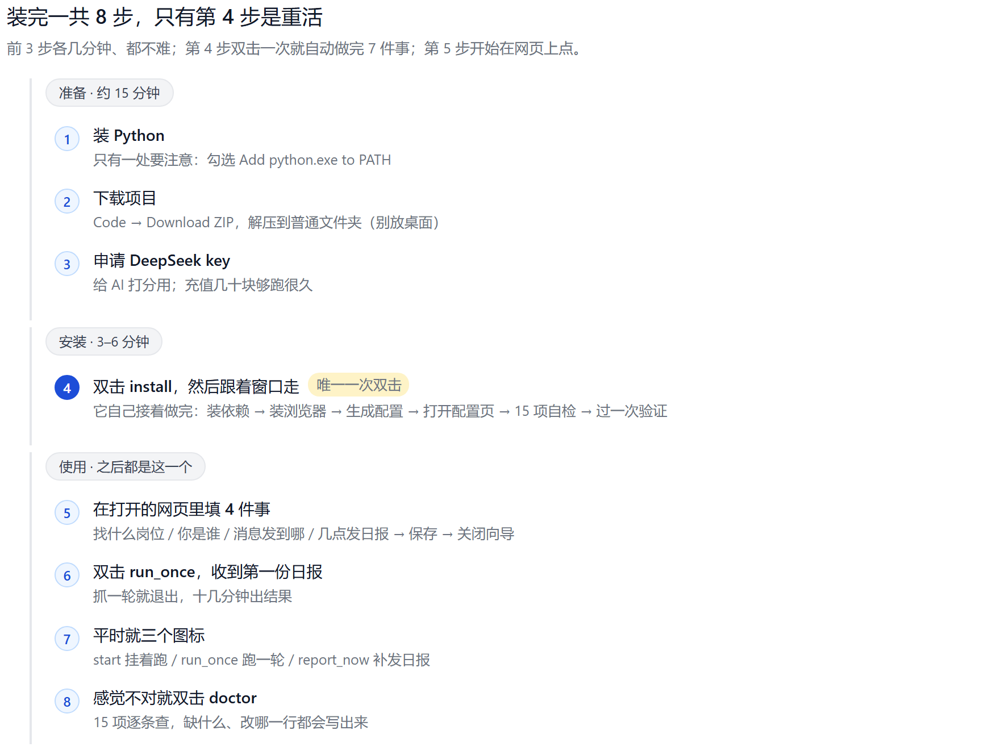
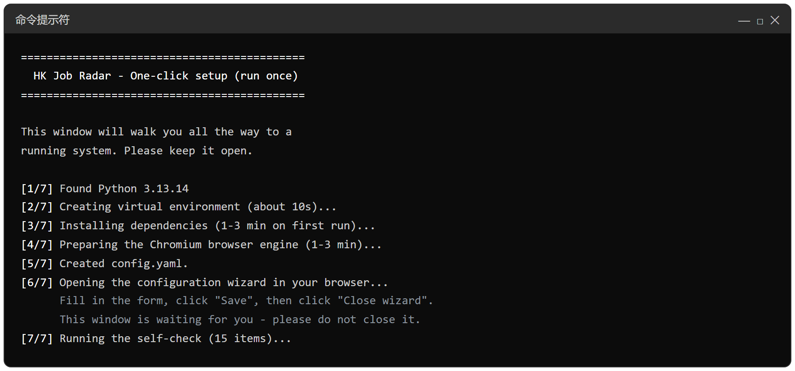
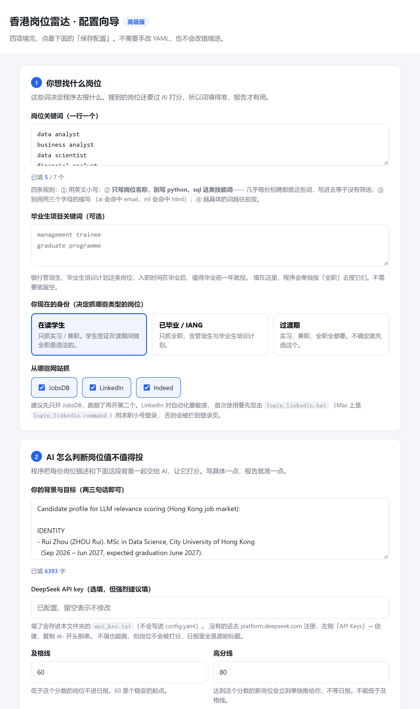
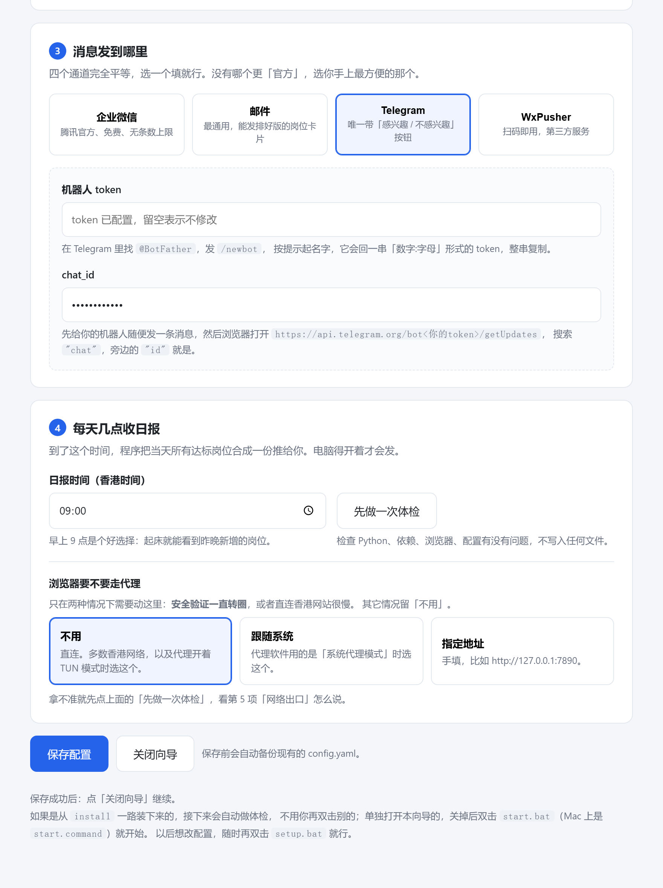
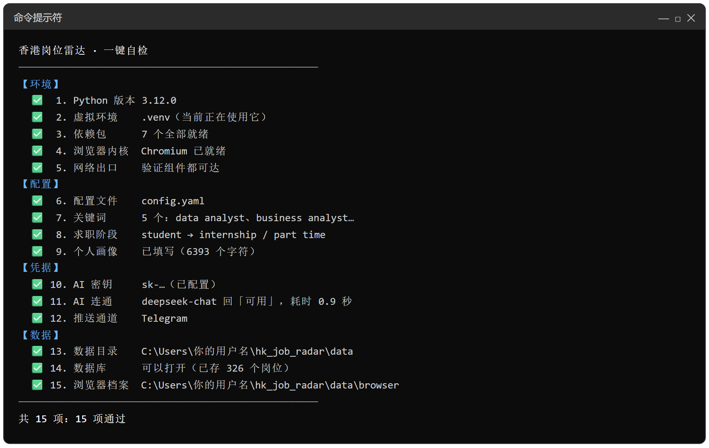
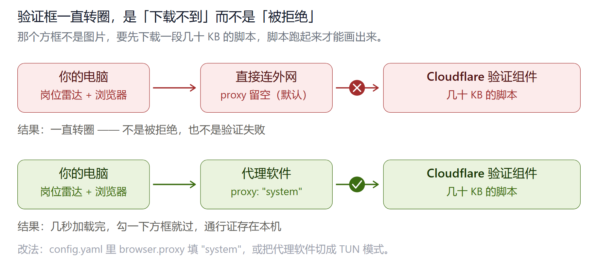

# 零基础保姆级教程（不需要任何编程经验）

> 这份教程假设你**从没打开过黑色命令行窗口、没听过 GitHub、不懂编程**。
> 每一步都会写清楚：**点哪里、输入什么、会看到什么、出问题了怎么办**。
>
> 全程大约 30 分钟，其中**只有一次双击是重活**（第 4 步），其余都是几分钟的小事。
> 装完之后每天早上会自动收到一份岗位日报。



---

> ## 推送通道有 4 个，任选其一即可
>
> 本项目支持 **四个完全平等的推送通道**——**企业微信** / **邮件** / **Telegram** / **WxPusher**。
> 你只需要选**一个**（免费版限一个），四个通道没有谁是「默认」或「二等」。
>
> | 通道 | 一句话 | 内地网络 |
> |---|---|---|
> | **企业微信** | 腾讯官方、免费、无条数上限、消息进微信 | ✅ 可直连 |
> | **邮件** | 最通用，能收到排好版的 HTML 岗位卡片 | ✅ 可直连 |
> | **Telegram** | 唯一能点「感兴趣 / 不感兴趣」按钮的 | ⚠️ 需自备网络条件 |
> | **WxPusher** | 扫码即用，第三方服务、有免费额度上限 | ✅ 可直连 |
>
> **第 5 步会让你从这四张卡片里点一张**，配置就跟着变。
> 不管选哪个，后面所有步骤都一样。

---

## 一、这个工具是什么（30 秒版）

它会自动帮你盯着香港三大求职网站（JobsDB / LinkedIn / Indeed）的新岗位，
把匹配你要求的岗位打分排序后，**推送到你自选的那个通道**（默认早上 9 点；9 点电脑没开的话，
开机跑完第一轮就补发），像订阅一份「专属求职日报」。你不用再每天手动刷新好几个网站。

你只需要做两件事：
1. **今天**：跟着下面 8 步装好它（只需一次）；
2. **以后**：每天开机后双击一个图标，剩下的它全自动。

---

## 二、开始前，你需要准备

| 需要 | 说明 |
| --- | --- |
| 一台 Windows 电脑 | Win 10 / 11 均可（Mac 用户看 [mac-安装教程.md](mac-安装教程.md)） |
| 网络 | 能正常上网（香港本地网络即可，不需要 VPN） |
| 一个邮箱 | 用于注册下面的免费账号 |
| 一部手机或一台电脑 | 用来接收日报 —— 第 5 步选的通道在哪，就在哪收 |

需要注册**一个免费账号**：

- **DeepSeek**（AI 打分用的，有免费额度）

推送通道可能还需要一样东西，取决于你选哪个（第 5 步会带你拿）：
企业微信的 webhook / 邮箱的授权码 / Telegram 的机器人 token / WxPusher 的 appToken。

---

## 三、名词小词典（看不懂后面某些词时回来查）

| 名词 | 大白话解释 |
| --- | --- |
| 终端 / 命令行 | 就是一个黑色（或白色）的窗口，靠打字跟电脑对话。本教程里**你几乎不用它**，因为我们都做成了「双击就能跑」的文件 |
| GitHub | 程序员放代码的网站，相当于「代码版网盘」。你只需要从这里下载文件 |
| Python | 一种编程语言。这个工具是用它写的，所以电脑要先装它（第 1 步） |
| 虚拟环境 | 给这个工具单独准备的「工具箱」，不影响你电脑里的其他东西，卸载也干净 |
| API key | 一串以 `sk-` 开头的「通行证文字」，证明「AI 服务是你注册的」。要保密，别发给别人。本项目把 key 存在项目文件夹的 `api_key.txt` 里 |
| 人机验证 / 过盾 | 求职网站防机器人的那道检查（类似进小区刷一次门禁）。**不需要账号密码**，只要你在浏览器里亲手过一次 |
| Telegram | 一款聊天软件（类似微信）。**只有你选它当通道时**，日报才通过它发给你 |
| bot（机器人） | Telegram 里的自动化账号。选 Telegram 通道时，日报由它发给你 |

---

## 第 1 步：安装 Python（约 5 分钟）

Python 是运行本工具的基础，装一次就行。

1. 打开浏览器，访问：**https://www.python.org/downloads/**
2. 点击页面中间黄色的 **「Download Python 3.x.x」** 大按钮，文件会下载到你的电脑（约 30 MB）。
3. 下载完成后，双击运行这个安装文件。
4. **关键一步**：安装窗口的**最底部**，有一个小勾选框
   **「Add python.exe to PATH」**——**必须勾上它**（90% 的新手问题都出在漏勾这个）。
5. 然后点击 **「Install Now」**，等待进度条走完（1-2 分钟）。
6. 看到 **「Setup was successful」** 字样，点右上角 **Close** 关闭。

✅ 自查：按键盘 `Win + R`，输入 `cmd` 回车，在黑色窗口里输入
`python --version` 再回车。如果显示类似 `Python 3.13.1` 就说明装好了。
（如果显示「不是内部或外部命令」，说明上面第 4 条的勾漏了，重装一次并勾上。）

---

## 第 2 步：下载本项目（约 2 分钟）

1. 打开项目页面：**https://github.com/prui0474/hk-job-radar**
2. 点击绿色的 **「Code」** 按钮。
3. 在弹出的小菜单里点 **「Download ZIP」**，会下载一个压缩包。
4. 找到下载好的压缩包（一般在「下载」文件夹，名叫 `hk-job-radar-main.zip`），
   **右键 → 全部解压**（或「解压到当前文件夹」）。
5. 解压后你会得到一个文件夹 `hk-job-radar-main`。**建议把它移到一个你
   长期放的地方**（比如 `D:\hk-job-radar`），以后这个工具就一直住在这里，
   别装完就删。

✅ 自查：打开这个文件夹，能看到 `install.bat`、`start.bat` 等文件就对了。

---

## 第 3 步：申请 DeepSeek API key（约 5 分钟）

> **为什么这一步排在第 4 步前面？**
> 因为第 4 步的安装窗口会问你「有没有 key」。先把它准备好，安装时就能直接过，
> 不会卡在那里现查怎么申请。

这个 key 是「AI 打分」的通行证。DeepSeek 有免费额度，个人轻度使用基本够。

1. 打开浏览器，访问：**https://platform.deepseek.com/**
2. 点 **「注册」**，用手机号或邮箱注册并登录。
3. 登录后，看**左侧菜单**，点 **「API Keys」**。
4. 点 **「创建 API key」**，名字随便填（比如 `job-radar`），点确定。
5. 页面会显示一串以 **`sk-`** 开头的长文字——**这就是你的 key**。
   点旁边的复制按钮复制它。
   ⚠️ 这个 key **只显示这一次**，请立刻复制保存好（比如先粘贴到记事本）。
   ⚠️ 不要发给任何人。
6. 把 key 存到项目文件夹里，让程序能读到它。**存成 `api_key.txt` 这个文件**：
   - 打开项目文件夹（就是有 `install.bat` 的那个文件夹）；
   - 在文件夹的**空白处右键 → 新建 → 文本文档**；
   - 把文件名从「新建文本文档.txt」改成 **`api_key.txt`**，
     然后按回车确认——
     ⚠️ 如果系统弹出「如果改变文件扩展名，文件可能无法使用」，点**是**；
     ⚠️ 改完后要确认名字就是 `api_key.txt`，不是 `api_key.txt.txt`
     （可以在文件夹里点「查看 → 显示 → 文件扩展名」避免踩坑）；
   - **双击打开它**，把你复制的 key（`sk-` 开头那一串）**粘贴进去**，
     文件里**只放这一行**，不要加引号、不要加空格；
   - 按 `Ctrl+S` 保存，关闭。
7. 以后程序启动时会**自动读取**这个文件，不用再设置别的东西。

> **换 key 或填错了？** 直接用记事本打开 `api_key.txt` 改掉内容、保存即可。
>
> **不想现在弄也行**：第 4 步安装时可以按回车跳过，第 5 步在网页里也能填。
> 但没有 key 就不会给岗位打分，日报里全是原始标题。

---

## 第 4 步：双击 install，一条链装完（约 3–6 分钟）

**这是唯一需要你双击的一次。** 装完环境它会自己接着做后面几件事，
中途不用你判断「现在该点哪个文件」。

1. 打开项目文件夹，找到 **`install.bat`**，**双击**它。
2. 会弹出一个黑色窗口，自动开始。窗口里会依次出现 **7 个编号**：



| 编号 | 它在做什么 | 要你做什么 |
|---|---|---|
| `[1/7]` | 检查 Python | 无 |
| `[2/7]` | 建一个专用工具箱（虚拟环境） | 无 |
| `[3/7]` | 装依赖包 | 无，等 1–3 分钟 |
| `[4/7]` | 下载浏览器内核（Chromium） | 无，等 1–3 分钟 |
| `[5/7]` | 生成配置文件 + 读你的 key | 有 `api_key.txt` 就自动跳过 |
| `[6/7]` | **自动打开配置网页** | **这一屏要你操作**，见第 5 步 |
| `[7/7]` | 15 项自检 | 无，等 10 秒 |
| 最后 | 自动弹出浏览器过一次验证 | 勾一下方框，回窗口按回车 |

3. **耐心等，不要关窗口。** 总时长约 3–6 分钟（取决于网速）。
4. 到 `[6/7]` 时浏览器会自动打开一个中文页面 —— **去第 5 步**，填完点保存，
   再点页面上的「关闭向导」，然后**回到这个黑色窗口**，它会继续往下跑。
5. `[7/7]` 自检全绿后，它会**直接弹出一个浏览器窗口**，让你过一次 JobsDB 的安全验证 ——
   在那个窗口里勾一下「我不是机器人」，等网站正常显示后**回到黑色窗口按一次回车**。
   （这一步不需要账号密码；当时跳过了也不要紧，以后双击 `login_jobsdb.bat` 可以补。）
6. 最后看到 **`全部就绪。`** 就成功了。

> 💡 **为什么窗口里的标题是英文？**
> Windows 的命令行对中文支持很不稳定——写在 `.bat` 文件里的中文会被错误拆解，
> 轻则乱码，重则把提示文字当成命令执行，报出一堆「不是内部或外部命令」。
> 所以本项目让 `.bat` **只保留最短的英文步骤标题**，所有长句说明都交给程序用中文打印
> （你在窗口里看到的中文段落，就是这部分）。看到英文标题别慌，对照上面那张表就行。

❌ 如果中途出现 `[X]` 开头的报错：把**整个黑窗口截图**发给 AI（比如我），
会告诉你怎么解决。最常见的失败原因是网断了，**重新双击 `install.bat` 重试**即可
（重跑时已经装好的东西会自动跳过，不会重装一遍，也不会覆盖你的配置）。

> 📌 **一个不要动的地方**：`requirements.txt` 的**第一行**
> `# -*- coding: utf-8 -*-` 别删、别挪位置。
> 简体中文 Windows 默认用 GBK 解码文本，删掉这行会让安装报
> `UnicodeDecodeError: 'gbk' codec can't decode ...`。你不需要懂它，留着就行。

---

## 第 5 步：在配置页面里填 4 件事（约 10 分钟）

第 4 步到 `[6/7]` 时，浏览器会自动打开一个本地页面（地址是 `127.0.0.1` 开头）。
**这个页面只在你本机能打开**，同一 WiFi 下的其他电脑连不上；关掉窗口后地址就失效了。

页面上从上到下就 4 块，最下面是「保存配置」按钮。





### 5a. 四块分别填什么

| 第几块 | 填什么 | 注意 |
|---|---|---|
| 1 | **你想找什么岗位** | 页面上预填了 5 个示例岗位，那是给你当起点的，**请改成你自己的**。有橙色提示就是在提醒你改 |
| 2 | **AI 怎么判断值不值得投** | 这是**最重要的一块**：写你是谁、会什么、想投哪类岗。写得越具体，打分越准 |
| 3 | **消息发到哪里** | 点你要用的那张卡片，其余会自动变灰（免费版只能选一个）。凭据见 5b |
| 4 | **每天几点收日报** | 默认 09:00。早上 9 点电脑没开也没关系，开机后第一轮会自动补发 |

**第 1 块的填词规则**（照做就不会白抓）：

- 写**岗位名称**，不要写技能名词（别写 `python`、`excel`，那些是技能不是岗位）；
- 不写太短的缩写（比如 `ai`、`ml`、`ba`，会在无关岗位的描述里被误命中）；
- **更具体的词写在前面**（`"financial analyst"` 要排在 `"analyst"` 前面）；
- 免费版最多 **7 个**（包括下面「毕业前岗位」那一栏，两栏合起来算）。

往下还有一栏「**毕业生岗位关键词**」，专门放「毕业后入职的管培生 / 毕业生项目」
（management trainee 之类）。还在读书、也考虑这类机会就填这里，不需要就留空。

**第 2 块怎么写**：先写身份（学校 / 专业 / 毕业时间），再写你会什么（技能、实习），
最后写**目标岗位的先后顺序**和**你不想要的**（比如「不要纯数据录入」「不要 996」）。
这三句话就够 AI 判断了，不用写成一篇作文。

> 不想自己憋？把简历复制给 DeepSeek，让它「按这三句话的结构帮我写一段 150 字的自我介绍」，
> 再粘进来。

### 5b. 第 3 块的凭据怎么拿

四个通道的凭据不是同一种东西，各有一份一步一步的教程（写到「点哪颗按钮、输入什么」这一级）：

| 你选的通道 | 看这篇的第几节 |
|---|---|
| 企业微信 | [推送渠道对比.md](推送渠道对比.md) 的「三、通道 A：企业微信」 |
| 邮件 | [推送渠道对比.md](推送渠道对比.md) 的「四、通道 B：邮件」 |
| Telegram | [推送渠道对比.md](推送渠道对比.md) 的「五、通道 C：Telegram」 |
| WxPusher | [推送渠道对比.md](推送渠道对比.md) 的「六、通道 D：WxPusher」 |

拿到之后，粘进第 3 块对应通道的那几个框里。

> 页面上出现「已配置，留空表示不修改」是正常的 —— 说明上次填过的值已经保存，
> 你不改它就保持原样。

### 5c. 保存，然后发一条试试（别跳）

1. 点页面最下面的 **「保存配置」**。
2. 看到保存成功的提示后，点 **「关闭向导」**。
3. 回到黑色窗口，它会自己接着做体检和验证（第 4 步那张表里 `[7/7]` 和「最后」两行）。
4. 想确认通道真的通：双击 **`notify_test.bat`**，它会真的发一条消息到你手机上，
   10 秒内收到就对了。

没收到：看 [推送渠道对比.md](推送渠道对比.md) 最后那节「收不到消息？按这个顺序查」，
里面有四种通道各自的排查顺序。

---

## 第 6 步：双击 run_once，收到第一份日报（约 10 分钟）

1. 双击项目文件夹里的 **`run_once.bat`**。
2. 黑色窗口开始滚动日志，你会看到类似：
   `开始抓取` / `关键词初筛：86 → 12` / `LLM 打分完成：12 个成功`。
3. 跑完它会自动退出。**打开你第 5 步选的那个通道**（企业微信 / 邮箱 / Telegram / WxPusher）
   —— 日报已经在那了。
4. 这一天之内再跑，不会重复发日报；有新岗位出现时会单独推送。

🎉 到这里就装完了。以后每天：**开机 → 双击 start.bat → 去忙别的**。

> 第一次跑可能要几分钟，因为要真的打开浏览器去几个网站抓岗位。
> 如果 JobsDB 那一站提示「还没过过人机验证」，看[附 B](#附-b安全验证一直转圈怎么办)。

---

## 第 7 步：日常怎么用（就几个图标）

| 双击它 | 作用 | 什么时候用 |
| --- | --- | --- |
| `start.bat` | 开始自动监控（挂着跑） | 电脑会开比较久的时候 |
| `run_once.bat` | **抓一轮 → 推日报 → 自动退出** | 只想开十几分钟就拿结果（推荐日常用这个）|
| `report_now.bat` | 立刻补发一次日报（强制，不查是否已发过）| 刚开机想马上看今天岗位 |
| `login_jobsdb.bat` | 重新过 JobsDB 的防护验证（**不需要账号密码**） | 日报突然没岗位 / 日志提示过盾时 |
| `login_linkedin.bat` | 登录 LinkedIn（**需要账号**，可选两条路） | 想让 LinkedIn 抓到更多岗位时 |
| `login_indeed.bat` | 单独确认 Indeed 能不能过验证（**不需要账号**） | 想先摸清 Indeed 那站通不通时 |
| `doctor.bat` | **15 项体检，逐条告诉你哪里没配好** | 装完第一次、或任何「感觉不对」的时候 |
| `setup.bat` | **打开网页改配置**（关键词、身份、推送通道、日报时间）| 想换岗位方向、换推送方式、改时间的时候 |

停止监控：直接关掉黑色窗口即可。

---

## 第 8 步：感觉不对，就双击 doctor 查一遍（约 1 分钟）

装完之后最容易出问题的地方是「填了但填错位置」「少复制了一段」「key 多了个空格」。
**`doctor.bat` 会替你把所有环节查一遍**，一共 15 项：



```
【环境】Python 版本 / 虚拟环境 / 依赖包 / 浏览器内核 / 网络出口
【配置】配置文件 / 关键词 / 求职阶段 / 个人画像
【凭据】AI 密钥 / AI 连通 / 推送通道
【数据】数据目录 / 数据库 / 浏览器档案
```

**怎么用**：

1. 双击 `doctor.bat`，等它跑完（约 10 秒，其中「AI 连通」会真连一次网）。
2. **只看带 ❌ 的行**：`→` 后面就是该做什么，照着改。
3. 改完再双击一次，直到**全部变绿**。

> 三个符号的意思：
> `✅` 没问题 · `⚠️` 能用但建议改 · `❌` 必须改，不改会抓不到岗位或收不到日报。
>
> 提示里的编号就是行号，按编号找最快。

其中第 5 项「**网络出口**」查的是：你这边的网络能不能连上安全验证要用的那几个域名。
它不通的话，页面会一直转圈 —— 那不是你哪里填错了，具体见[附 B](#附-b安全验证一直转圈怎么办)。

---

## 附 A：不用网页，手工改配置文件

> **绝大多数人不需要看这一节。** 第 5 步的网页已经能改全部设置。
> 但有人就喜欢改文本文件，也有人（比如在服务器上）打不开浏览器 —— 那一节就是给这两种情况的。
>
> 手工改完，同样要双击 `doctor.bat` 复查一遍。

### A1. 填通道凭据（以 Telegram 为例）

> 选的是企业微信 / 邮件 / WxPusher 的话，字段名不一样 ——
> 对照 [推送渠道对比.md](推送渠道对比.md) 里你那一节末尾的 `config.yaml` 片段，
> 位置就在 `config.yaml` 的 `notify:` 段里。

1. 打开项目文件夹，找到 **`config.yaml`**（第 4 步 install 已自动生成）。
2. **右键它 → 打开方式 → 记事本**。
   （找不到「记事本」就点「选择其他应用」，在列表里找「记事本 / Notepad」。）
3. 按 `Ctrl+F` 搜索 `bot_token`，找到 `bot_token: ""` 这一行，
   把凭据粘贴进两个引号中间：

   ```yaml
   bot_token: "1234567890:AAExampleTokenReplaceMeHere"
   ```

4. 再搜索 `chat_id`，把数字填进去：

   ```yaml
   chat_id: "1234567891"
   ```

5. 按 `Ctrl+S` 保存，关闭记事本。

✅ 自查：`bot_token` 和 `chat_id` 两行的引号里都有内容了，其他行不用动。

### A2. 把岗位关键词换成你自己的（**必须做**）

关键词决定程序去搜什么。**这一栏必须换成你自己的** —— 照抄别人的词，
抓回来的是别人的岗位。

> 模板里 `keywords` 是空的（`keywords: []`），要自己写。
> 用网页配置的话，页面会预填一组示例词，那是给你当起点用的，**请改掉**。

1. 在同一个记事本窗口里，按 `Ctrl+F` 搜索 `keywords:`，找到这一段。
2. 它现在长这样（一对空方括号）：

   ```yaml
   keywords: []
   ```

   把它**整行替换**成你自己的岗位名称，一行一个，**每个都用英文双引号包起来**，
   并且整段**顶格写**（不加空格）。例如找金融方向的岗位：

   ```yaml
   keywords:
     - "investment analyst"
     - "risk analyst"
     - "financial analyst"
     - "asset management"
   ```

3. **三条填词规则**（照做就不会白抓）：
   - 写**岗位名称**，不要写技能名词（别写 `python`、`excel`）；
   - 不写太短的缩写（`ai`、`ml`、`ba` 会被无关描述误命中）；
   - **更具体的词写在前面**（`"financial analyst"` 排在 `"analyst"` 前面）。
4. 保存（`Ctrl+S`）。

> 免费版最多 **7 个**，「毕业生岗位关键词」（`graduate_keywords`）也计入这 7 个。

### A3. 填个人画像（`data/profiles/profile.yaml`）

> 用网页配置的话，这一步就是第 5 步第 2 块那个大文本框，不必再开记事本。

这一步填的内容决定「**找到岗位之后，怎么判断哪个值得看**」。
工具会把每个岗位交给 AI 打一个 **0-100 的相关度分数**，而 AI 打分的**唯一依据**
就是这份自我介绍。所以：

- 写得越具体 → 分数越准，日报里排在前面的越是你真正想要的；
- 空着、或还是一堆占位符 → 分数基本靠猜，日报会混入大量你不想要的结果。

> ⚠️ 这是全流程最容易踩的坑：跳过这一步程序**不会报错**、看起来一切正常，
> 但用的是「一段与实际无关的通用介绍」在打分 —— 你会以为工具不好用，其实是画像没填。

**怎么改**：

1. 打开项目文件夹，依次进入 **`data`** → **`profiles`** 两个子文件夹。
2. 找到 **`profile.yaml`**（第 4 步 install 已自动生成；旁边的
   `profile.example.yaml` 是原始模板，**不要动它**）。
3. **右键 → 打开方式 → 记事本**。里面是一份英文的「填空题」，
   有很多用尖括号 `< >` 包起来的占位符，比如 `<Your Name>`、`<University>`。

| 段落 | 作用 | 要不要改 |
| --- | --- | --- |
| `background:` | **给 AI 打分的自我介绍**（最关键） | ✅ 一定要改 |
| `basic:` | 姓名 / 邮箱 / 电话（投递副驾填表用） | ✅ 建议改 |
| `education:` / `work_experience:` | 学历、实习经历 | ✅ 建议改 |
| `job_preferences:` / `screening_rules:` | 目标岗位、期望薪资、签证回答口径 | ✅ 建议改 |

> 模板是英文的，因为英文描述与英文岗位的语义匹配效果最好。
> 想用中文写也可以，但**建议 `background:` 尽量用英文**。

**最省力的填法**：把简历发给 DeepSeek 网页版，再加上 `profile.yaml` 的整段模板，说：

> 这是我的简历。请严格按下面这份 YAML 模板的格式，把我的真实信息填进去，
> 替换掉所有 `<...>` 占位符；其中 `background:` 段请用英文写、写得具体一些
> （尤其是「目标岗位的先后顺序」和「排除项」）。直接输出完整的 YAML，不要解释。

回来之后**全选复制 → 覆盖记事本里的内容 → 保存**。
⚠️ 填完自己核对一遍姓名、学校、毕业时间，AI 有时会自作主张补内容。

**只想先跑通**：把 `background:` 段里那几个 `<Your Name>`、`<University>`、`<Role 1>`
换成你自己的信息就行，其余先不管 —— **关键是别留着一堆 `<占位符>`**。

✅ 自查：在记事本里按 `Ctrl+F` 搜 `<`，基本搜不到就说明替换得差不多了。

---

## 附 B：安全验证一直转圈怎么办

先分清一件事：**转圈不等于失败**。失败会有红字、会让你重试；一直转，
说明「验证需要的那段程序根本没下载下来」。



双击 `doctor.bat`，看第 5 项「网络出口」，它会直接告诉你是哪种情况：

| 它显示 | 说明 | 你该做的 |
|---|---|---|
| ✅ 验证组件都可达 | 网络没问题，卡在浏览器这一侧 | 看下面「情况二」 |
| ⚠️ 代理端口连不上 | 代理软件没开，或端口填错了 | 先打开代理软件，或核对端口 |
| ⚠️ 代理通了但目标不通 | 代理是好的，当前节点连不上 | 换一个节点回来再试 |
| ⚠️ 没配代理，也连不上 | 确实需要一条能出去的通道 | 看下面「情况一」 |

### 情况一：网络到不了验证组件

打开 `config.yaml`，找到 `browser:` 这一段，把 `proxy` 改成下面三种之一：

```yaml
browser:
  proxy: ""                        # 默认：强制直连，不读系统代理
  proxy: "system"                  # 跟随系统代理（代理软件开的是「系统代理模式」）
  proxy: "http://127.0.0.1:7890"   # 指定地址，端口按你代理软件里显示的改
```

| 办法 | 怎么做 | 什么时候用 |
|---|---|---|
| 1. 切 TUN 模式 | 打开代理软件，把模式从「系统代理」改成「TUN / 虚拟网卡」，再双击一次 `login_jobsdb.bat` | 多数代理软件都有这个开关，最省事，不用改配置 |
| 2. 填 `"system"` | 改上面那行，保存，再双击 `login_jobsdb.bat` | 你不想动代理软件的模式 |
| 3. 填具体地址 | 把 `"http://127.0.0.1:7890"` 里的端口改成你软件上显示的 | 前两个都不行时 |

> 不想开记事本？双击 `setup.bat`，页面第 4 块下面有同样的三个选项。

> ⚠️ 如果你的网络环境里完全没有可用的出口通道，这一步是过不去的。
> 这不是程序的问题，也不是你填错了 —— 需要先解决网络这一层。

### 情况二：网络通，但验证就是过不去

两个原因，都跟网络无关：

1. **复选框要你亲手点一下**。有些站点的验证不会自动开始，得你点一下那个
   「我不是机器人」的方框。
2. **当前出口 IP 被标成了高风险**。机房 IP、很多人共用的代理节点容易被这样标记。
   换一个节点回来再试，通常就过了。

### 顺带说清楚：三个站谁需要账号

这个经常被搞混 —— 三个站里只有一个真的需要登录：

| 站点 | 需要账号吗 | 双击哪个文件 | 它在做什么 |
|---|---|---|---|
| **JobsDB** | **不需要** | `login_jobsdb.bat` | 只过一次安全验证，把通行证存在本机 |
| **LinkedIn** | **需要**（建议用小号） | `login_linkedin.bat` | 真的登录，登录后能看到更多岗位 |
| **Indeed** | **不需要** | `login_indeed.bat` | 确认这站能不能过验证 |

所以「登录 JobsDB 失败」这个说法其实不准确 —— 那里没有账号可登，
它失败的唯一原因就是网络通道不对。

**LinkedIn 老是过不了验证怎么办**：双击 `login_linkedin.bat` 时选 **2**。
这条路不碰验证码 —— 你在自己日常用的浏览器里正常登录，它只把登录凭证
复制过来。具体做法脚本里会一步一步提示。

---

## 附 C：常见问题

**Q：黑窗口出现红色报错？**
不用怕。**整窗截图**发给 AI（比如我），描述「我做到第几步」，基本都能一句话解决。

**Q：报错里出现 `UnicodeDecodeError: 'gbk' codec can't decode byte ... in position ...`？**
这是简体中文 Windows 的「文本编码」老毛病：系统默认拿 GBK 去解码 UTF-8 的文件。
项目已经处理好了——**`requirements.txt` 的第一行 `# -*- coding: utf-8 -*-` 就是为了
解决这个问题**。正常情况下你不会再遇到它。
万一遇到，第一件事是确认那一行还在：**千万别删它**，删掉错误就会回来。

**Q：日报一直收不到？**
按顺序检查：① `start.bat` 的黑窗口还开着吗？② 双击 `report_now.bat` 看报错；
③ 双击 `doctor.bat`，看第 12 项「推送通道」和第 11 项「AI 连通」是不是 ✅；
④ 报错若提到 token/chat_id，回第 5 步第 3 块检查填对没有。

**Q：日报收到了，但推的岗位我根本不想要，或者分数看着很怪？**
九成是**个人画像没填或没填对**。双击 `setup.bat`，看第 2 块那个大文本框，
确认写的是**你自己的**真实背景——既不是一堆 `<占位符>`，也不是模板原文。
顺便再看一眼第 1 块的关键词是不是你的岗位方向。

**Q：想改找什么岗位？**
双击 `setup.bat`，改第 1 块，保存。改完重启 `start.bat`。
（手工改法见[附 A2](#a2-把岗位关键词换成你自己的必须做)）

**Q：换了个求职方向（比如从数据转金融），要改哪里？**
两处一起改：第 1 块的关键词（去哪儿找）+ 第 2 块的自我介绍（怎么打分）。
只改一处会出现「抓对了岗位、但打分还是按老方向」。

**Q：黑窗口提示「未配置 DEEPSEEK_API_KEY / LLM 打分无法工作」？**
说明程序还没拿到你的 key。按第 3 步做一个 **`api_key.txt`** 放进项目文件夹
（文件内容只有 `sk-` 开头那一串，别加引号），保存后重新双击运行即可。
如果已经做过，检查文件名是不是变成了 `api_key.txt.txt`、或里面多了空格/换行。

**Q：会不会把我的密码/key 泄露到网上？**
不会。所有 key 只存在你电脑本地，配置文件已被排除在上传范围外（见项目里的
`.gitignore`）。

**Q：电脑关机了怎么办？**
关机期间不会抓取，也不扣任何额度。下次开机重新双击 `start.bat` 即可，
还会自动补上最近的新岗位。

**Q：装完想彻底删掉？**
直接删掉整个项目文件夹即可。程序没有往系统里装别的东西
（Windows 上没有开机自启项；你装的 Python 可以留着，别的程序也用得上）。

---

*本教程对应项目版本：2026-10。界面若有小改动，以实际页面为准；卡住就截图问 AI。*
